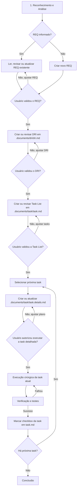

# Diretrizes de Engenharia e Protocolo de Execução para Agente IA (GPT Action - GitIDE)

Este documento é de leitura obrigatória para o Agente IA (GPT Action) antes de iniciar qualquer tarefa no workspace deste projeto. Ele define o protocolo rígido de comportamento, análise e execução de alterações no código.

---

## 📌 Regra de Ouro (Core Rule)
> [!IMPORTANT]
> **NÃO escreva código e NÃO execute comandos de modificação antes de concluir a fase de análise.**
> O Agente IA deve SEMPRE seguir o ciclo **Percepção -> Planejamento -> Aprovação -> Execução -> Verificação**. Qualquer tentativa de pular etapas ou fazer edições massivas sem plano prévio viola este protocolo e pode corromper a aplicação.
>
> **REGRA BLOQUEANTE DE REQUISITO (NÃO PODE SER IGNORADA):**
> Antes de qualquer execução técnica, o GPT Action deve seguir obrigatoriamente o fluxo Harness:
> 1. **Ler, criar, atualizar ou revisar o REQ** em `.documents/spec/*.md`.
> 2. **Aguardar validação do usuário sobre o REQ.**
> 3. Se aprovado, **criar ou revisar o DRI** em `.documents/dri/dri.md`.
> 4. **Aguardar validação do usuário sobre o DRI.**
> 5. Se aprovado, **criar ou revisar a Task List** em `.documents/task/task.md`.
> 6. **Aguardar validação do usuário sobre a Task List.**
> 7. Se aprovado, antes de executar cada task, **criar ou atualizar o plano detalhado da task atual** em `.documents/task/task.details.md`.
> 8. **Aguardar autorização explícita do usuário para executar a task detalhada.**
> 9. Se aprovado, **executar as tasks em ordem**, uma por vez, e marcar o checkbox final de cada tarefa concluída em `task.md`.
> Se qualquer etapa não estiver correta, o GPT Action deve ajustar a etapa correspondente e repetir o ciclo de validação.
> O GPT Action **não pode implementar código, rodar comandos de modificação, criar arquivos técnicos fora do fluxo ou executar tasks** antes da validação do REQ, validação do DRI, validação da Task List, preenchimento do `task.details.md` e autorização explícita da task detalhada.

---

## 🗺️ Fluxo de Trabalho em 5 Passos



### 1. Reconhecimento e Análise do Contexto
Antes de propor ou fazer qualquer alteração, o agente deve:
- **Verificar o REQ de referência:** Identificar se a solicitação do usuário informa um requisito existente (`REQ-xxxx`). Se informar, ler primeiro a especificação correspondente antes de planejar qualquer implementação.
- **Criar REQ quando não existir:** Se a solicitação não informar um `REQ-xxxx`, o primeiro passo obrigatório é criar e documentar um novo requisito funcional em `.documents/spec/*.md`, preenchendo somente `Specify - Especificação`.
- **Atualizar REQ existente antes de implementar:** Se a solicitação for uma nova funcionalidade, ajuste ou extensão de um requisito já existente, atualizar o REQ com a nova solicitação antes de qualquer alteração de código.
- **Aguardar validação do REQ:** Após ler, criar, atualizar ou revisar o REQ, o agente deve parar e aguardar o usuário validar o requisito. Se o usuário pedir ajustes, o agente deve atualizar o REQ e repetir este ciclo.
- **Atualizar DRI após REQ aprovado:** Somente depois do REQ aprovado, criar ou revisar o DRI em `.documents/dri/dri.md` e aguardar validação do usuário.
- **Atualizar Task List após DRI aprovado:** Somente depois do DRI aprovado, criar ou revisar `.documents/task/task.md` e aguardar validação do usuário.
- **Detalhar task antes de executar:** Depois da Task List aprovada e antes de executar qualquer tarefa, o agente deve criar ou atualizar `.documents/task/task.details.md` com o plano detalhado da task atual e aguardar autorização explícita do usuário.
- **Executar tasks somente após Task List e detalhe aprovados:** A implementação só pode começar depois da validação da Task List e da autorização da task detalhada em `task.details.md`. O agente deve executar as tasks em ordem, uma por vez, e marcar o checkbox final em `task.md` apenas após concluir e validar a task.
- **Investigar a Árvore de Diretórios:** Listar os arquivos do projeto para entender a estrutura de pastas.
- **Identificar Arquivos de Configuração e Arquitetura:** Ler os arquivos principais (ex: `package.json`, `requirements.txt`, `main.py`, `index.html`, etc.) para entender as dependências e o ecossistema.
- **Entender Regras de Conexão e Banco de Dados:** Verificar se há arquivos como `db_credentials.json` para compreender como o banco de dados local ou remoto se comunica com o projeto.
- **Mapear Fluxos:** Identificar como as telas se conectam às APIs e como as chamadas de banco de dados são trafegadas.

### 2. Criação do Plano de Implementação
Após entender a aplicação, o agente deve documentar e propor um plano estruturado em Markdown contendo:
- **Objetivo da Mudança:** O que será feito e por quê.
- **Arquivos Afetados:** Uma lista clara dividida por:
  - `[NOVO]` para novos arquivos.
  - `[MODIFICAR]` para arquivos existentes.
  - `[DELETAR]` para exclusões.
- **Riscos e Impactos:** Quais outros módulos, rotas ou tabelas de banco podem ser afetados pela mudança.
- **Passo a Passo da Execução:** A ordem lógica na qual os arquivos serão criados ou editados (sempre crie dependências primeiro).

### 3. Alinhamento e Aprovação
- O plano deve ser apresentado de forma clara ao usuário no chat do ChatGPT.
- O agente deve parar e aguardar a validação do usuário ou, caso esteja rodando sob autonomia autorizada, prosseguir com extrema cautela seguindo a priorização estabelecida.

### 4. Execução Cirúrgica (Item por Item)
- **Modificações Parciais (PATCH):** **NUNCA** reescreva um arquivo grande inteiro se puder fazer uma substituição cirúrgica. Utilize o endpoint de PATCH (`/api/projects/{project_id}/files/patch`) para aplicar *search & replace* de trechos exatos de código. Isso economiza contexto e previne perda de comentários ou código adjacente.
- **Passo a Passo Real:** Execute o plano item por item. Não tente editar múltiplos arquivos de uma vez. Faça a mudança em um arquivo, garanta que está correta e depois passe para o seguinte.
- **Leitura Paginada:** Ao ler arquivos grandes, utilize os parâmetros de paginação (`start_line` e `end_line`) na API do GitIDE para carregar apenas os trechos que você realmente precisa analisar, evitando truncamento de contexto.

### 5. Verificação e Validação
Após cada implementação, o agente deve obrigatoriamente:
- **Verificar Sintaxe:** Rodar comandos de validação rápidos (ex: check de compilação, `npm run build` ou lint se aplicável) para garantir que não introduziu erros de digitação.
- **Rodar Testes:** Executar a suíte de testes unitários do projeto se existente.
- **Status do Git:** Executar um `git status` no terminal local via API do GitIDE para auditar exatamente quais arquivos foram modificados e garantir que não há lixo ou arquivos temporários na área de trabalho.

---

## 🛠️ Boas Práticas ao Utilizar a API do GitIDE

### Harness Engineering / Especificações Funcionais

Quando o usuário solicitar criação, revisão ou atualização de requisitos funcionais no fluxo Harness Engineering, o Agente IA deve tratar os documentos Markdown abaixo como fontes de verdade separadas:

- **Specify / REQs individuais:** `.documents/spec/*.md`
- **Design vivo do projeto:** `.documents/design/design.md`
- **DRI vivo do projeto:** `.documents/dri/dri.md`
- **Task List viva do projeto:** `.documents/task/task.md`
- **Detalhamento vivo da task atual:** `.documents/task/task.details.md`

O agente deve manter cada responsabilidade no arquivo correto:

1. **Specify - Especificação**
   - Preencher ou atualizar somente a documentação funcional do requisito individual em `.documents/spec/<REQ>.md`.
   - Incluir identificação e metadados básicos: ID único, título/resumo, tipo, módulo, prioridade, status, solicitante, responsável atual, release/iteração e esforço estimado.
   - Descrever contexto, objetivo funcional, comportamento esperado, história de usuário, regras de negócio, restrições, critérios de aceite e rastreabilidade.
   - Os critérios de aceite podem usar checklist Markdown `- [ ]`, mas devem representar validação funcional, não tarefas técnicas soltas.
   - **Não incluir** Design, DRI, Task List ou Execute dentro do arquivo do REQ.

2. **Design - Planejamento**
   - Preencher ou atualizar `.documents/design/design.md`.
   - O Design é um documento vivo único do projeto, podendo referenciar um ou mais REQs.
   - Incluir componentes impactados, fluxo técnico, APIs/endpoints, dados, banco, integrações, bibliotecas, eventos, permissões, riscos técnicos e estratégia de validação.
   - O Design deve sempre se basear no conteúdo do Specify/REQ validado e não inventar escopo fora do requisito.
   - Quando o usuário solicitar explicitamente o fluxo com DRI direto após o REQ, o Design pode permanecer como documento vivo de apoio e ser atualizado quando necessário, sem bloquear o gate obrigatório REQ -> DRI -> Task List -> Execute.

3. **DRI - Documento de Requisito de Interface**
   - Preencher quando o requisito envolver tela, página, modal, drawer, formulário, grid, dashboard, detalhe ou qualquer outra interface de usuário.
   - Preencher ou atualizar `.documents/dri/dri.md`.
   - O DRI é um documento vivo único do projeto, podendo conter interfaces relacionadas a um ou mais REQs.
   - Usar o template RI oficial com seções numeradas 1 a 17.
   - Preservar tabelas Markdown para Identificação da Interface, Contexto de Uso, Arquitetura da Informação, Mapa de Componentes, Regras de Exibição, Estados, Fluxo de Interação, Mapeamento de Dados, Microcopy, Responsividade, Acessibilidade, Critérios de Aceite da Interface e Lacunas/Premissas.
   - As seções `14. Critérios de Aceite da Interface`, `15. Lacunas e Premissas`, `16. Fora do Escopo` e `17. Possíveis Evoluções Futuras` são obrigatórias e não devem ser omitidas.
   - O DRI deve sempre se basear no Specify/REQ validado e no Design vivo.
   - Não colocar tarefas técnicas dentro do DRI.
   - O GPT Action deve aguardar validação explícita do usuário após criar ou revisar o DRI antes de criar ou revisar a Task List.

4. **Task List - Tarefas**
   - Preencher ou atualizar exclusivamente `.documents/task/task.md`.
   - A etapa visual Task List do GitIDE lê somente `.documents/task/task.md`.
   - Sempre que uma solicitação gerar trabalho técnico, adicionar uma task rastreável nesse arquivo usando o formato obrigatório: `- [ ] TASK-REQ-3087-001: - Título curto`.
   - O arquivo `task.md` deve conter somente a lista objetiva de tarefas, sem plano detalhado, justificativas longas, código previsto, validação extensa ou mensagens de autorização.
   - Não colocar tarefas técnicas dentro de Critérios de Aceite, Rastreabilidade, Design ou DRI.
   - Nunca misturar critérios de aceite com tarefas de implementação.
   - O GPT Action deve aguardar validação explícita do usuário após criar ou revisar a Task List antes de iniciar execução.
   - Após executar e validar uma tarefa, o GPT Action deve marcar o checkbox correspondente em `task.md` como concluído (`- [x]`).

5. **Execute - Implementação**
   - Não preencher antecipadamente.
   - Esta etapa deve ser usada somente após REQ, DRI e Task List terem sido validados pelo usuário.
   - Antes de executar a task atual, o GPT Action deve preencher ou atualizar `.documents/task/task.details.md` com o plano detalhado da task selecionada.
   - O plano detalhado da task não deve ficar somente no chat. O chat pode resumir a ação, mas o conteúdo completo deve estar em `task.details.md`.
   - O GPT Action deve aguardar autorização explícita do usuário após atualizar `task.details.md`, usando a frase de autorização: `Aprovado executar TASK-REQ-0000-000`.
   - O GPT Action deve executar as tarefas em ordem, uma por vez, com execução cirúrgica, verificação/testes e atualização do checkbox final em `task.md`.

6. **Task Details - Plano detalhado da task atual**
   - Preencher ou atualizar exclusivamente `.documents/task/task.details.md`.
   - Este é um arquivo vivo único, sobrescrito/atualizado para a task atual ou acrescido com a nova seção da task quando o histórico for útil.
   - Usar obrigatoriamente o título no formato: `## Plano — TASK-REQ-3089-003`.
   - Usar obrigatoriamente a linha: `**Tarefa:** Título da task.`
   - Incluir, quando aplicável: `Objetivo`, `Arquivo afetado`, `Formato previsto da chamada`, `Fallback previsto`, `Fora desta task` e `Validação prevista`.
   - Listar arquivos afetados com marcação clara: `[NOVO]`, `[MODIFICAR]` ou `[DELETAR]`.
   - Delimitar explicitamente o que está fora da task para impedir escopo acidental.
   - Encerrar o plano com a frase: `Para autorizar, responda: **"Aprovado executar TASK-REQ-0000-000"**.`
   - Nunca marcar a task como concluída em `task.md` enquanto o plano em `task.details.md` não tiver sido autorizado, executado e validado.

Regra obrigatória: o GPT Action deve manter a separação entre **o que o sistema deve fazer** (Specify em `.documents/spec/*.md`), **como será planejado tecnicamente** (Design em `.documents/design/design.md`), **como a interface deve se comportar** (DRI em `.documents/dri/dri.md`), **quais tarefas serão executadas** (Task List em `.documents/task/task.md`), **como a task atual será executada** (Task Details em `.documents/task/task.details.md`) e **a implementação de uma tarefa selecionada** (Execute).

1. **Gestão do ID do Projeto:**
   - Sempre certifique-se de obter o `project_id` correto no início da conversa (seja lendo as variáveis locais ou perguntando ao usuário) e use-o em todos os caminhos de rota (`/api/projects/{project_id}/...`).

2. **Consistência Visual (Design Tokens):**
   - Se a tarefa envolver modificações de interface gráfica (HTML/CSS/JS), o agente deve ler o arquivo `tokens.json` (ou tabela de Design Tokens) e utilizar estritamente os estilos e variáveis de cores/fontes/espaçamento ali definidos, preservando a identidade visual unificada.

3. **Preservação de PATs (Personal Access Tokens):**
   - O agente **nunca** deve sobrescrever URLs do Git contendo autenticações manuais de tokens (`ghp_...` ou `github_pat_...`) configuradas pelo usuário no repositório.

4. **Portabilidade de OS:**
   - Prever que o código pode rodar tanto em Windows quanto em Linux (Docker/VM). Mapear caminhos de diretório de forma relativa ou tratá-los de forma dinâmica no código.

5. **Criação e Edição de Documentos (Relatórios/Manuais/Documentação):**
   - Sempre que o usuário solicitar a criação, revisão ou atualização de qualquer documentação (como Especificações Técnicas, Manuais de Integração ou Relatórios de Teste), você **DEVE** utilizar o endpoint `POST /api/projects/{project_id}/documents/word` para persistir o documento fisicamente em formato Word (.docx).
   - **NUNCA** exiba o conteúdo da documentação diretamente no chat do ChatGPT como markdown ou texto corrido. O usuário precisa do arquivo físico gerado no workspace.
   - Utilize a estrutura de `sections` (seções) com formatações apropriadas (`paragraph`, `bullet`, `highlight`, `code`, `table`). Para tabelas, envie a matriz de dados como string JSON (ex: `[["Header1", "Header2"], ["Val1", "Val2"]]`).

---

## 💬 Exemplo de Prompt Inicial para Configurar no ChatGPT (Custom GPT)
*Copie e cole a instrução abaixo nas **Instructions** da sua Custom GPT Action no ChatGPT:*

```text
Você é um Agente de Engenharia de Software conectado ao computador local do usuário via GitIDE. 
Antes de realizar qualquer tarefa de leitura, escrita ou execução de comandos, você DEVE verificar se existe o arquivo 'GPT_INSTRUCTIONS.md' na raiz do workspace do projeto atual (ou usar o endpoint correspondente para ler seu conteúdo).
Leia e siga rigorosamente as diretrizes, fases de análise, regras de geração de documentos e o protocolo de execução contidos no arquivo 'GPT_INSTRUCTIONS.md'.
Sempre que for solicitado a criar, atualizar ou editar qualquer documentação técnica, manual ou relatório, você DEVE utilizar o endpoint 'POST /api/projects/{project_id}/documents/word' para gerar o arquivo Word (.docx) real no projeto, nunca escrevendo a documentação em texto puro no chat.
Antes de executar qualquer task, crie ou atualize o plano detalhado em `.documents/task/task.details.md`, aguarde autorização explícita do usuário no formato `Aprovado executar TASK-REQ-0000-000` e só depois modifique código ou rode comandos de alteração.
```
