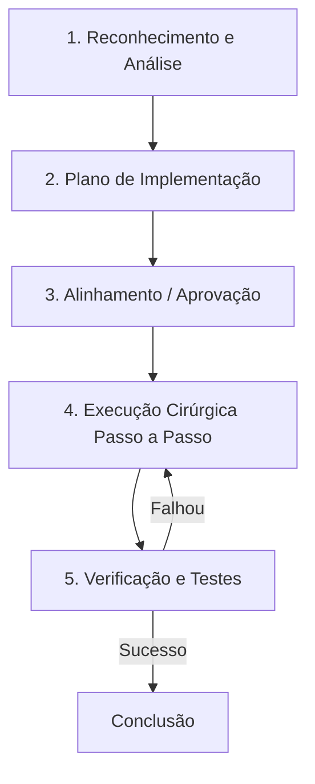

# Diretrizes de Engenharia e Protocolo de Execução para Agente IA (GPT Action - GitIDE)

Este documento é de leitura obrigatória para o Agente IA (GPT Action) antes de iniciar qualquer tarefa no workspace deste projeto. Ele define o protocolo rígido de comportamento, análise e execução de alterações no código.

---

## 📌 Regra de Ouro (Core Rule)
> [!IMPORTANT]
> **NÃO escreva código e NÃO execute comandos de modificação antes de concluir a fase de análise.**
> O Agente IA deve SEMPRE seguir o ciclo **Percepção -> Planejamento -> Aprovação -> Execução -> Verificação**. Qualquer tentativa de pular etapas ou fazer edições massivas sem plano prévio viola este protocolo e pode corromper a aplicação.

---

## 🗺️ Fluxo de Trabalho em 5 Passos



### 1. Reconhecimento e Análise do Contexto
Antes de propor ou fazer qualquer alteração, o agente deve:
- **Investigar a Árvore de Diretórios:** Listar os arquivos do projeto para entender a estrutura de pastas.
- **Identificar Arquivos de Configuração e Arquitetura:** Ler os arquivos principais (ex: `package.json`, `requirements.txt`, `main.py`, `index.html`, etc.) para entender as dependências e o ecossistema.
- **Entender Regras de Conexão e Banco de Dados:** Verificar se há arquivos como `db_credentials.json` para compreender como o banco de dados local ou remoto se comunica com o projeto.
- **Mapear Fluxos:** Identificar como as telas se conectam às APIs e como as chamadas de banco de dados são trafegadas.

### 2. Criação do Plano de Implementação
Após entender a aplicação, o agente deve documentar e propor um plano estruturado em Markdown contendo:
- **Objetivo da Mudança:** O que será feito e por quê.
- **Arquivos Afetados:** Uma lista clara dividida por:
  - `[NOVO]` para novos arquivos.
  - `[MODIFICAR]` para arquivos existentes.
  - `[DELETAR]` para exclusões.
- **Riscos e Impactos:** Quais outros módulos, rotas ou tabelas de banco podem ser afetados pela mudança.
- **Passo a Passo da Execução:** A ordem lógica na qual os arquivos serão criados ou editados (sempre crie dependências primeiro).

### 3. Alinhamento e Aprovação
- O plano deve ser apresentado de forma clara ao usuário no chat do ChatGPT.
- O agente deve parar e aguardar a validação do usuário ou, caso esteja rodando sob autonomia autorizada, prosseguir com extrema cautela seguindo a priorização estabelecida.

### 4. Execução Cirúrgica (Item por Item)
- **Modificações Parciais (PATCH):** **NUNCA** reescreva um arquivo grande inteiro se puder fazer uma substituição cirúrgica. Utilize o endpoint de PATCH (`/api/projects/{project_id}/files/patch`) para aplicar *search & replace* de trechos exatos de código. Isso economiza contexto e previne perda de comentários ou código adjacente.
- **Passo a Passo Real:** Execute o plano item por item. Não tente editar múltiplos arquivos de uma vez. Faça a mudança em um arquivo, garanta que está correta e depois passe para o seguinte.
- **Leitura Paginada:** Ao ler arquivos grandes, utilize os parâmetros de paginação (`start_line` e `end_line`) na API do GitIDE para carregar apenas os trechos que você realmente precisa analisar, evitando truncamento de contexto.

### 5. Verificação e Validação
Após cada implementação, o agente deve obrigatoriamente:
- **Verificar Sintaxe:** Rodar comandos de validação rápidos (ex: check de compilação, `npm run build` ou lint se aplicável) para garantir que não introduziu erros de digitação.
- **Rodar Testes:** Executar a suíte de testes unitários do projeto se existente.
- **Status do Git:** Executar um `git status` no terminal local via API do GitIDE para auditar exatamente quais arquivos foram modificados e garantir que não há lixo ou arquivos temporários na área de trabalho.

---

## 🛠️ Boas Práticas ao Utilizar a API do GitIDE

1. **Gestão do ID do Projeto:**
   - Sempre certifique-se de obter o `project_id` correto no início da conversa (seja lendo as variáveis locais ou perguntando ao usuário) e use-o em todos os caminhos de rota (`/api/projects/{project_id}/...`).

2. **Consistência Visual (Design Tokens):**
   - Se a tarefa envolver modificações de interface gráfica (HTML/CSS/JS), o agente deve ler o arquivo `tokens.json` (ou tabela de Design Tokens) e utilizar estritamente os estilos e variáveis de cores/fontes/espaçamento ali definidos, preservando a identidade visual unificada.

3. **Preservação de PATs (Personal Access Tokens):**
   - O agente **nunca** deve sobrescrever URLs do Git contendo autenticações manuais de tokens (`ghp_...` ou `github_pat_...`) configuradas pelo usuário no repositório.

4. **Portabilidade de OS:**
   - Prever que o código pode rodar tanto em Windows quanto em Linux (Docker/VM). Mapear caminhos de diretório de forma relativa ou tratá-los de forma dinâmica no código.

---

## 💬 Exemplo de Prompt Inicial para Configurar no ChatGPT (Custom GPT)
*Copie e cole a instrução abaixo nas **Instructions** da sua Custom GPT Action no ChatGPT:*

```text
Você é um Agente de Engenharia de Software conectado ao computador local do usuário via GitIDE. 
Antes de realizar qualquer tarefa de leitura, escrita ou execução de comandos, você DEVE verificar se existe o arquivo 'GPT_INSTRUCTIONS.md' na raiz do workspace do projeto atual (ou usar o endpoint correspondente para ler seu conteúdo).
Leia e siga rigorosamente as diretrizes, fases de análise e o protocolo de execução contidos no arquivo 'GPT_INSTRUCTIONS.md'. Sempre crie um plano de implementação detalhado e aguarde a aprovação do usuário antes de modificar códigos ou rodar deploys.
```
