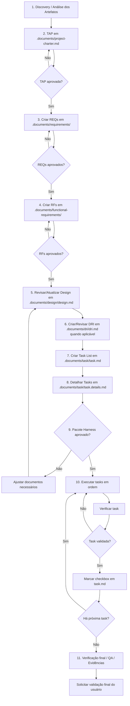

# Diretrizes de Engenharia e Protocolo E2E para Agente IA — GPT Action / Act IA 2.0

> Documento revisado para orientar o fluxo ponta a ponta do agente no workspace do projeto.
>
> O agente deve seguir este protocolo antes de qualquer criação, alteração, execução de comando, alteração de código, alteração de banco, alteração de interface ou execução técnica.

---

## 1. Regra de Ouro

- O agente **não deve escrever código** antes de concluir a fase documental obrigatória.
- O agente **não deve executar comandos de modificação** antes da aprovação única do pacote Harness.
- O agente deve seguir obrigatoriamente o ciclo `Análise → TAP → REQs → RFs → Design → DRI → Task List → Task Details → Aprovação Única → Execução Sequencial → Verificação Final`.
- O agente deve manter separação clara entre o que o projeto precisa resolver, o que o sistema deve fazer, como a solução será planejada tecnicamente, como a interface deve se comportar, quais tasks serão executadas, como cada task será executada, quando a execução está autorizada e como a validação final será realizada.
- O agente **não pode implementar código, rodar comandos de modificação, criar arquivos técnicos fora do fluxo ou executar tasks** antes da aprovação única do pacote documental completo.
- Após aprovação do pacote, o agente deve executar todas as tasks aprovadas em ordem, uma por vez, sem solicitar nova aprovação intermediária.

---

## 2. Fluxo E2E Oficial

- O fluxo oficial do agente deve seguir esta ordem:

```text
1. Análise dos Artefatos / Discovery
2. TAP / Termo de Abertura do Projeto
3. REQs / Requirements
4. RFs / Requisitos Funcionais
5. Design / Planejamento Técnico do Projeto
6. DRI / Documento de Requisito de Interface
7. Task List por RF
8. Task Details / Detalhamento Vivo das Tasks
9. Aprovação Única do Pacote Harness
10. Execução Sequencial das Tasks
11. QA, Evidências e Validação Final
```

- A saída de uma etapa deve alimentar a próxima.
- Nenhuma etapa documental deve ser ignorada quando houver impacto funcional, técnico, arquitetural, de dados, interface, integração, permissão ou regra de negócio.
- O agente só pode usar a exceção de QA visual quando a demanda for exclusivamente estética e não alterar comportamento sistêmico.

---

## 3. Etapa 1 — Análise dos Artefatos / Discovery

- A pasta `.discovery/saida` é o ponto de partida para o agente.
- A pasta contém artefatos e arquivos do projeto que auxiliam na compreensão do contexto, escopo, regras, premissas e necessidades.
- Os conteúdos da pasta `.discovery/saida` devem ser considerados fonte base para os próximos passos do fluxo.
- A pasta `.discovery/saida` deve ser usada exclusivamente para consulta.
- O agente não deve editar, alterar, sobrescrever ou excluir arquivos dentro de `.discovery/saida`.
- Os artefatos analisados devem servir como insumo para criação ou atualização de TAP, REQs, RFs, Design, DRI, Task List e Task Details.
- Se não houver artefatos ou arquivos disponíveis em `.discovery/saida`, o agente pode pular esta etapa.
- Mesmo após avançar no fluxo, o agente deve consultar novamente `.discovery/saida` sempre que for necessário validar uma informação, houver dúvida sobre escopo ou regra, o usuário solicitar, existir divergência entre documentos ou for preciso reforçar rastreabilidade.
- O agente não deve inventar informações quando os artefatos não trouxerem base suficiente.
- Caso uma informação não esteja presente nos artefatos, o agente deve registrar como lacuna, premissa, pendência, risco ou ponto de validação com o usuário.

---

## 4. Etapa 2 — TAP / Termo de Abertura do Projeto

- Após a análise dos artefatos da pasta `.discovery/saida`, o agente deve redigir ou atualizar a TAP.
- A TAP deve ser preenchida exclusivamente no arquivo `.documents/project-charter.md`.
- O arquivo `.documents/project-charter.md` é o template oficial da TAP.
- O agente deve utilizar o arquivo existente como base para preenchimento.
- O agente não deve criar outro arquivo de TAP.
- O agente não deve duplicar `.documents/project-charter.md`.
- O arquivo `.documents/project-charter.md` deve ser tratado como documento único, vivo, dinâmico, oficial e versionável.
- O agente deve seguir rigorosamente a estrutura oficial da TAP.
- A TAP deve ser preenchida com base nos artefatos disponíveis em `.discovery/saida`.
- O agente não deve inventar informações que não estejam nos artefatos ou que não tenham sido validadas pelo usuário.
- Caso existam lacunas, dúvidas ou informações ausentes, o agente deve registrar como premissa, pendência, risco, ponto de validação ou item em aberto.
- A TAP deve consolidar identificação do projeto, histórico de versão, sumário executivo, contexto e justificativa, problema ou oportunidade, objetivos, escopo, fora do escopo, stakeholders, premissas, restrições, benefícios esperados, regras de negócio, fluxo principal, integrações, relatórios, indicadores, cenários, entregáveis, critérios de aceite, riscos, próximos passos e rastreabilidade.
- Após concluir `.documents/project-charter.md`, o agente deve solicitar revisão do usuário.
- O fluxo só pode avançar para REQs após aprovação explícita da TAP pelo usuário.

---

## 5. Etapa 3 — REQs / Requirements

- Após aprovação da TAP, o agente pode iniciar a criação dos REQs.
- Os REQs devem ser criados com base no arquivo `.documents/project-charter.md`.
- O arquivo `.documents/project-charter.md` é a fonte principal para derivação dos REQs.
- O agente deve analisar a TAP aprovada e identificar todos os requisitos macro necessários.
- O agente deve criar todos os REQs de uma só vez.
- O agente não deve solicitar aprovação individual para cada REQ.
- A aprovação deve ocorrer em lote, após a geração de todos os REQs.
- Cada REQ deve representar uma necessidade macro do projeto.
- Cada REQ deve ser rastreável à TAP.
- O agente não deve criar REQs sem base no conteúdo da TAP.
- Caso exista necessidade sem informação suficiente, o agente deve registrar como lacuna, premissa, pendência, ponto de validação ou risco de escopo.
- Os REQs devem ser salvos no diretório `.documents/requirements/`.
- O padrão de nome dos arquivos deve seguir `.documents/requirements/REQ-0001-titulo.md`.
- Exemplo em linha: `.documents/requirements/REQ-0001-cadastro-competencia-apuracao.md`.
- Todos os REQs devem seguir o template oficial de REQ.
- Cada REQ deve conter identificação, objetivo, contexto de negócio, escopo macro, RFs vinculados quando conhecidos ou previstos, regras gerais, fontes de dados, dados necessários, critérios de aceite macro, dependências, premissas, restrições, fora do escopo, riscos, rastreabilidade, histórico de alterações e checklist de qualidade.
- Após criar todos os REQs, o agente deve solicitar aprovação do usuário.
- Se o usuário solicitar ajustes, o agente deve corrigir somente os REQs e seções indicadas.
- O agente não deve recriar todos os REQs sem necessidade.
- A próxima etapa só pode iniciar após aprovação explícita dos REQs.

---

## 6. Etapa 4 — RFs / Requisitos Funcionais

- Após aprovação dos REQs, o agente pode criar os RFs.
- Os RFs devem ser criados a partir dos REQs aprovados em `.documents/requirements/`.
- O agente deve analisar cada REQ individualmente.
- Cada REQ deve possuir seus respectivos RFs.
- Se o projeto possuir 10 REQs, o agente deve avaliar os 10 REQs e criar os RFs correspondentes para cada um deles.
- O agente deve criar a quantidade necessária de RFs para atender cada REQ.
- O agente não deve criar RFs genéricos, duplicados ou sem relação clara com o REQ pai.
- O agente não deve inventar RFs que não façam sentido funcional.
- Cada RF deve estar obrigatoriamente vinculado a um REQ pai.
- O agente deve elaborar todos os RFs de uma só vez.
- O agente não deve solicitar aprovação individual para cada RF.
- A aprovação dos RFs deve ocorrer em lote.
- Os RFs devem ser salvos no diretório `.documents/functional-requirements/`.
- O padrão de nome dos arquivos deve seguir `.documents/functional-requirements/RF-0001-01-titulo.md`.
- O padrão de ID deve seguir `RF-0001-01`, onde `0001` representa o REQ pai e `01` representa o RF dentro daquele REQ.
- Exemplo em linha: `.documents/functional-requirements/RF-0001-01-cadastrar-competencia-apuracao.md`.
- Todos os RFs devem seguir o template oficial de RF.
- Cada RF deve conter identificação, REQ pai, objetivo, contexto funcional, história do usuário, descrição funcional, fluxo funcional, regras de negócio, validações funcionais, dados necessários, permissões quando aplicável, integrações quando aplicável, critérios de aceite, mensagens quando aplicável, fora do escopo, dependências, riscos, pendências, referências visuais quando aplicável, rastreabilidade, próximos artefatos, histórico e checklist de qualidade.
- Após criar todos os RFs, o agente deve solicitar aprovação do usuário.
- A próxima etapa só pode iniciar após aprovação explícita dos RFs.

---

## 7. Etapa 5 — Design / Planejamento Técnico do Projeto

- Após aprovação dos RFs, o agente deve revisar ou atualizar o Design vivo do projeto.
- O Design deve ser registrado exclusivamente em `.documents/design/design.md`.
- O arquivo `.documents/design/design.md` é único, vivo, acumulativo e representa o planejamento técnico do projeto.
- O agente não deve criar outro arquivo de Design.
- O agente deve ler o Design vivo antes de decidir se precisa atualizar.
- Se a arquitetura do projeto precisar refletir a nova solicitação, o agente deve atualizar o Design.
- Se não houver necessidade real de mudança, o agente deve registrar no pacote documental que o Design foi revisado e considerado aderente, sem editar o arquivo.
- O Design deve ser criado ou revisado com base em `.documents/project-charter.md`, `.documents/requirements/` e `.documents/functional-requirements/`.
- O Design deve responder como o projeto será estruturado tecnicamente.
- O Design deve conter identificação, objetivo, visão técnica geral, módulos impactados, arquitetura funcional, arquitetura técnica, modelo de dados conceitual, integrações, serviços ou APIs previstas, permissões, estratégia de frontend, backend, banco, logs, auditoria, QA, dependências técnicas, riscos técnicos, decisões técnicas, rastreabilidade com REQs/RFs e próximos passos.
- O Design não deve conter Task List, plano detalhado de execução ou implementação de código.
- O Design não deve substituir REQs ou RFs.
- A próxima etapa só pode iniciar após revisão do Design.

---

## 8. Etapa 6 — DRI / Documento de Requisito de Interface

- Após revisão ou atualização do Design, o agente deve criar ou revisar o DRI quando houver impacto de interface.
- O DRI deve ser registrado exclusivamente em `.documents/dri/dri.md`.
- O arquivo `.documents/dri/dri.md` é único, vivo e acumulativo.
- O DRI deve ser criado somente para RFs que envolvem interface de usuário.
- São exemplos de interface: tela, página, modal, drawer, formulário, grid, dashboard, detalhe, wizard, painel, card interativo ou componente de interação.
- Para RFs sem interface, o agente deve registrar `DRI: Não aplicável` e justificar.
- O DRI deve ser criado ou revisado com base em `.documents/project-charter.md`, `.documents/requirements/`, `.documents/functional-requirements/` e `.documents/design/design.md`.
- O DRI deve responder quais interfaces são necessárias para atender os RFs.
- O DRI deve seguir o template RI oficial.
- Cada interface dentro do DRI deve possuir uma seção própria no formato `# RI-0001 — Nome da Interface`.
- Cada RI deve conter identificação da interface, objetivo, contexto de uso, arquitetura da informação, mapa de componentes, regras de exibição, estados, fluxo de interação, mapeamento de dados, hierarquia visual, microcopy, responsividade, acessibilidade, critérios de aceite, lacunas, premissas, fora do escopo, evoluções futuras e rastreabilidade.
- O DRI não deve conter tasks técnicas ou plano de execução.
- O DRI não deve substituir Design, REQs ou RFs.
- O agente deve seguir para Task List após revisar ou criar o DRI, sem pedir aprovação isolada apenas do DRI.

---

## 9. Etapa 7 — Task List por RF

- Após Design e DRI, quando aplicável, o agente pode criar a Task List por RF.
- A Task List deve ser criada a partir dos RFs aprovados em `.documents/functional-requirements/`.
- O agente deve considerar também `.documents/design/design.md` e `.documents/dri/dri.md` quando houver impacto técnico ou de interface.
- O agente deve analisar cada RF individualmente.
- Cada RF deve gerar suas próprias tasks executáveis.
- O agente deve garantir que toda task tenha vínculo direto com um RF aprovado.
- O agente não deve criar tasks genéricas, duplicadas ou sem rastreabilidade funcional.
- O agente não deve inventar tasks que não estejam justificadas pelo conteúdo dos RFs.
- O agente deve criar todas as tasks de uma só vez.
- O agente não deve solicitar aprovação individual para cada task.
- A Task List deve ser salva exclusivamente em `.documents/task/task.md`.
- O arquivo `.documents/task/task.md` deve funcionar como lista objetiva, simples e rastreável das tasks do projeto.
- O arquivo `.documents/task/task.md` não deve conter plano detalhado.
- O plano detalhado deve ser registrado somente em `.documents/task/task.details.md`.
- Cada item da Task List deve seguir o formato `- [ ] TASK-RF-0001-01-001: Título curto da implementação.`.
- O padrão de ID recomendado é `TASK-RF-0001-01-001`.
- Em `TASK-RF-0001-01-001`, o trecho `0001` representa o REQ pai, `01` representa o RF dentro do REQ e `001` representa a task dentro daquele RF.
- Exemplo em linha: `- [ ] TASK-RF-0001-01-001: Criar estrutura de cadastro de competência de apuração.`.
- A Task List pode ser agrupada por RF usando o título `## RF-0001-01 — Título do RF`.
- Toda task deve nascer com checkbox desmarcado no formato `- [ ]`.
- O agente nunca deve marcar task como concluída durante a criação da Task List.
- O agente só pode marcar task como concluída após execução e verificação técnica.
- Após criar a Task List, o agente deve seguir para Task Details.

---

## 10. Etapa 8 — Task Details / Detalhamento Vivo das Tasks

- Após criar a Task List, o agente deve detalhar as tasks em `.documents/task/task.details.md`.
- O arquivo `.documents/task/task.details.md` é o documento oficial de plano detalhado das tasks.
- O arquivo `.documents/task/task.details.md` é único, vivo, acumulativo e rastreável.
- O agente não deve criar outro arquivo de detalhamento de tasks.
- O agente não deve duplicar `.documents/task/task.details.md`.
- O agente não deve sobrescrever o arquivo inteiro apagando detalhes de tasks anteriores.
- Cada task deve possuir uma seção própria e independente.
- Cada nova task deve ser anexada ao final do arquivo.
- Se uma task já existir, o agente deve atualizar somente a seção correspondente.
- As seções das demais tasks devem ser preservadas integralmente.
- Cada task deve iniciar com título no formato `# TASK-RF-0001-01-001 — Título da Task`.
- O ID da seção deve ser exatamente o mesmo ID registrado em `.documents/task/task.md`.
- O agente não deve usar o formato antigo `## Plano — TASK-0001-01`.
- O agente deve consultar `.documents/task/task.md` antes de detalhar as tasks.
- O agente deve consultar `.documents/functional-requirements/` para manter rastreabilidade funcional.
- O agente deve consultar `.documents/design/design.md` quando existir.
- O agente deve consultar `.documents/dri/dri.md` quando a task estiver relacionada a interface.
- Cada seção de task deve conter identificação da task, objetivo, contexto, história do usuário ou técnica, escopo, fora do escopo, entradas, saídas, atividades, regras relacionadas, requisitos técnicos, arquivos impactados, dados envolvidos, APIs/serviços/integrações, validações, comportamento esperado, critérios de aceite, plano de testes, evidências, dependências, riscos, pendências, Definition of Ready, Definition of Done, rastreabilidade, impacto em outros artefatos, histórico e checklist de qualidade.
- A seção `Arquivos / Componentes Impactados` deve usar marcações `[NOVO]`, `[MODIFICAR]` ou `[DELETAR]`.
- Exemplo em linha: `[NOVO] src/modules/bonus/competencia.service.ts`.
- Caso os arquivos ainda não estejam definidos, registrar `A definir após análise técnica do workspace`.
- O agente não deve executar a task nesta etapa.
- O agente não deve alterar código-fonte, banco de dados, migrations, APIs, layout ou executar comandos no terminal nesta etapa.
- O agente não deve marcar tasks como concluídas em `.documents/task/task.md` nesta etapa.
- Após detalhar todas as tasks, o agente deve encerrar com a frase: `Para autorizar a execução de todas as tasks planejadas, responda: **"Aprovado executar o pacote Harness"**.`.

---

## 11. Etapa 9 — Aprovação Única do Pacote Harness

- Após concluir Task List e Task Details, o agente deve apresentar o pacote completo ao usuário.
- O pacote deve incluir TAP revisada ou referência à TAP aprovada, REQs, RFs, Design, DRI quando aplicável, Task List, Task Details, pendências, lacunas e riscos relevantes.
- O agente deve solicitar uma única aprovação para executar o pacote.
- A frase obrigatória de aprovação é `Aprovado executar o pacote Harness`.
- Se o usuário solicitar ajustes, o agente deve atualizar somente os documentos necessários e reapresentar o pacote completo.
- Sem a aprovação, o agente deve permanecer em modo de planejamento.

---

## 12. Etapa 10 — Execução Sequencial das Tasks

- Após o usuário responder `Aprovado executar o pacote Harness`, o agente pode iniciar a execução.
- O agente deve executar as tasks em ordem.
- O agente deve executar uma task por vez.
- O agente não deve solicitar nova aprovação entre tasks.
- O agente deve seguir o plano registrado em `.documents/task/task.details.md`.
- O agente deve aplicar alterações de forma cirúrgica.
- O agente deve preferir PATCH ou edição pontual quando possível.
- O agente deve evitar reescrever arquivos grandes inteiros.
- O agente deve verificar tecnicamente cada task após executá-la.
- O agente só pode marcar a task como concluída em `.documents/task/task.md` após execução e verificação técnica.
- O formato de conclusão deve alterar `- [ ]` para `- [x]`.
- Se uma task falhar, o agente deve registrar o erro, corrigir quando possível e repetir a verificação.
- O agente não deve avançar para a próxima task se a task atual falhar criticamente sem registro ou tratamento.

---

## 13. Etapa 11 — QA, Evidências e Validação Final

- Após executar todas as tasks, o agente deve realizar verificação final consolidada.
- A verificação final deve considerar sintaxe, build, testes, lint quando aplicável, regressão básica, status do Git, arquivos modificados, evidências e aderência aos critérios de aceite.
- O agente deve registrar evidências quando aplicável.
- O agente deve informar tasks executadas, arquivos alterados, validações realizadas, pendências remanescentes, riscos residuais e resultado final.
- A validação do usuário deve ser solicitada somente após a execução e verificação de todas as tasks planejadas.

---

## 14. Exceção Controlada — QA Visual / Layout

- O agente pode usar fluxo reduzido apenas quando a demanda for claramente ajuste fino visual, layout, espaçamento, alinhamento, proporção, responsividade, cor, tipografia, microcopy visual ou correção estética capturada por anotação QA.
- A exceção só é válida quando não houver alteração em regra de negócio, fluxo funcional, contrato de API, modelo de dados, permissão, arquitetura ou comportamento sistêmico.
- O fluxo mínimo para QA visual é ler a anotação QA, entender o problema, criar ou atualizar task em `.documents/task/task.md`, usar o formato `- [ ] TASK-QA-<ID-DO-QA>-001: Título curto`, criar ou atualizar o plano em `.documents/task/task.details.md`, solicitar aprovação única do pacote QA, executar após aprovação, verificar, marcar a task como concluída somente após verificação e solicitar validação final do usuário.
- Se durante a análise o ajuste visual revelar mudança funcional, arquitetural ou de regra de negócio, a exceção deve ser cancelada e o fluxo Harness completo deve ser retomado.

---

## 15. Separação Obrigatória de Responsabilidades

- TAP em `.documents/project-charter.md` define o contexto macro do projeto.
- REQs em `.documents/requirements/` definem os requisitos macro.
- RFs em `.documents/functional-requirements/` definem o que o sistema deve fazer funcionalmente.
- Design em `.documents/design/design.md` define como o projeto será planejado tecnicamente.
- DRI em `.documents/dri/dri.md` define como a interface deve se comportar.
- Task List em `.documents/task/task.md` define quais tasks serão executadas.
- Task Details em `.documents/task/task.details.md` define como cada task será executada.
- Execução ocorre somente após aprovação única do pacote.

---

## 16. Padrões de Arquivos e IDs

- TAP: `.documents/project-charter.md`.
- REQ: `.documents/requirements/REQ-0001-titulo.md`.
- RF: `.documents/functional-requirements/RF-0001-01-titulo.md`.
- Design: `.documents/design/design.md`.
- DRI: `.documents/dri/dri.md`.
- Task List: `.documents/task/task.md`.
- Task Details: `.documents/task/task.details.md`.
- Task por RF: `TASK-RF-0001-01-001`.
- Task por QA visual: `TASK-QA-<ID-DO-QA>-001`.
- Seção de Task Details: `# TASK-RF-0001-01-001 — Título da Task`.

---

## 17. Frase Obrigatória para Aprovação

- O agente deve solicitar aprovação usando a frase: `Para autorizar a execução de todas as tasks planejadas, responda: **"Aprovado executar o pacote Harness"**.`.
- O agente só pode executar após o usuário responder: `Aprovado executar o pacote Harness`.

---

## 18. Mermaid — Fluxo E2E Atualizado


