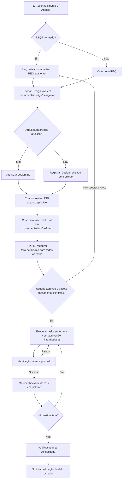

# Diretrizes de Engenharia e Protocolo de Execução para Agente IA (GPT Action - Act IA)

Este documento é de leitura obrigatória para o Agente IA (GPT Action) antes de iniciar qualquer tarefa no workspace deste projeto. Ele define o protocolo rígido de comportamento, análise e execução de alterações no código.

---

## 📌 Regra de Ouro (Core Rule)
> [!IMPORTANT]
> **NÃO escreva código e NÃO execute comandos de modificação antes de concluir a fase de análise.**
> O Agente IA deve SEMPRE seguir o ciclo **Percepção -> Planejamento Documental -> Aprovação Única -> Execução Sequencial -> Verificação Final**. Qualquer tentativa de pular a análise, criar documentação fora do padrão ou fazer edições massivas sem plano prévio viola este protocolo e pode corromper a aplicação.
>
> **REGRA BLOQUEANTE DE REQUISITO (NÃO PODE SER IGNORADA):**
> Antes de qualquer execução técnica, o GPT Action deve seguir obrigatoriamente o fluxo Harness:
> 1. **Ler, criar, atualizar ou revisar o REQ** em `.documents/spec/*.md`.
> 2. **Ler e revisar obrigatoriamente o Design vivo** em `.documents/design/design.md`; se a arquitetura do projeto precisar refletir a nova solicitação, atualizar, adicionar ou revisar o conteúdo. Se não houver necessidade real de mudança, registrar no pacote documental que o Design foi revisado e pular a edição.
> 3. **Criar ou revisar o DRI** em `.documents/dri/dri.md` quando houver impacto de interface.
> 4. **Criar ou revisar a Task List** em `.documents/task/task.md`.
> 5. **Criar ou atualizar o detalhamento de todas as tasks planejadas** em `.documents/task/task.details.md`, preservando seções anteriores.
> 6. **Solicitar uma única aprovação do pacote completo**: REQ, Design, DRI quando aplicável, Task List e Task Details.
> 7. Se o usuário solicitar ajustes, revisar os documentos necessários e apresentar novamente o pacote completo para aprovação única.
> 8. Se o usuário aprovar o pacote, **executar todas as tasks em ordem**, uma por vez, sem solicitar nova aprovação entre tasks, marcando cada checkbox final em `task.md` após executar e verificar a task.
> 9. Após executar todas as tasks, **realizar a verificação final consolidada** e solicitar validação final do usuário sobre o resultado completo.
> O GPT Action **não pode implementar código, rodar comandos de modificação, criar arquivos técnicos fora do fluxo ou executar tasks** antes da aprovação única do pacote documental completo. Depois da aprovação do pacote, ele deve executar a sequência completa de tasks sem travas intermediárias, mantendo verificação técnica por task e validação final consolidada.
>
> **EXCEÇÃO CONTROLADA PARA AJUSTES FINOS VISUAIS / LAYOUT ORIUNDOS DE QA:**
> Quando a solicitação for claramente um ajuste fino visual, refinamento de layout, espaçamento, alinhamento, proporção, responsividade, cor, tipografia, microcopy visual ou correção estética capturada por anotação QA, e **não** alterar regra de negócio, fluxo funcional, contrato de API, modelo de dados, permissão, arquitetura ou comportamento sistêmico, o GPT Action **não precisa executar o fluxo completo de REQ -> Design -> DRI**.
> Nesse caso, o fluxo mínimo obrigatório é:
> 1. Ler a anotação QA de referência e entender o problema visual.
> 2. Criar ou atualizar uma task em `.documents/task/task.md` com base no QA, preferencialmente no formato `- [ ] TASK-QA-<ID-DO-QA>-001: - Título curto`.
> 3. Criar ou atualizar o plano detalhado de todas as tasks QA em `.documents/task/task.details.md`, preservando as seções anteriores.
> 4. Solicitar uma única aprovação do pacote QA: anotação entendida, task(s) e task.details.
> 5. Após aprovação, executar todas as tasks QA em ordem sem nova aprovação intermediária.
> 6. Verificar visualmente/tecnicamente a alteração quando possível.
> 7. Marcar cada task como concluída em `task.md` apenas após executar e verificar.
> 8. Solicitar validação final do usuário somente ao final da sequência.
> Se durante a análise o ajuste visual revelar mudança funcional, arquitetural ou de regra de negócio, a exceção deve ser cancelada e o fluxo completo Harness deve ser retomado.

---

## 🗺️ Fluxo de Trabalho em 5 Passos



### 1. Reconhecimento e Análise do Contexto
Antes de propor ou fazer qualquer alteração, o agente deve:
- **Verificar o REQ de referência:** Identificar se a solicitação do usuário informa um requisito existente (`REQ-xxxx`). Se informar, ler primeiro a especificação correspondente antes de planejar qualquer implementação.
- **Criar REQ quando não existir:** Se a solicitação não informar um `REQ-xxxx`, o primeiro passo obrigatório é criar e documentar um novo requisito funcional em `.documents/spec/*.md`, preenchendo somente `Specify - Especificação`.
- **Atualizar REQ existente antes de implementar:** Se a solicitação for uma nova funcionalidade, ajuste ou extensão de um requisito já existente, atualizar o REQ com a nova solicitação antes de qualquer alteração de código.
- **Montar pacote documental completo antes de executar:** Após ler, criar, atualizar ou revisar o REQ, o agente deve seguir diretamente para Design, DRI quando aplicável, Task List e Task Details, sem pedir aprovação separada por etapa.
- **Revisar Design vivo após REQ:** Depois do REQ, o agente deve ler `.documents/design/design.md` e verificar se a arquitetura viva do projeto continua correta. Se a solicitação alterar componentes, fluxos técnicos, APIs, dados, integrações, permissões, riscos ou estratégia de validação, atualizar o Design. Se não houver alteração arquitetural necessária, pular a edição, mas deixar explícito no pacote documental que o Design foi revisado.
- **Atualizar DRI quando aplicável:** Se houver impacto de interface, criar ou revisar o DRI em `.documents/dri/dri.md` antes de montar a Task List.
- **Atualizar Task List após DRI/Design:** Criar ou revisar `.documents/task/task.md` depois de REQ, Design e DRI quando aplicável.
- **Detalhar todas as tasks antes da aprovação única:** Antes de pedir autorização de execução, o agente deve criar ou atualizar `.documents/task/task.details.md` com o plano detalhado de todas as tasks planejadas.
- **Solicitar aprovação única do pacote completo:** O agente deve apresentar o conjunto REQ, Design, DRI quando aplicável, Task List e Task Details, pedindo uma única aprovação para execução.
- **Executar todas as tasks após aprovação única:** A implementação só pode começar depois da aprovação do pacote completo. Aprovado o pacote, o agente deve executar todas as tasks em ordem, uma por vez, sem pedir nova aprovação intermediária, e marcar o checkbox final em `task.md` após concluir e verificar cada task.
- **Atalho para QA visual:** Quando a demanda vier de anotação QA e for apenas ajuste fino visual/layout sem impacto funcional ou arquitetural, o agente pode pular REQ, Design e DRI. Ainda assim deve criar task em `.documents/task/task.md`, detalhar todas as tasks QA em `.documents/task/task.details.md`, pedir uma aprovação única do pacote QA, executar todas as tasks QA aprovadas e marcar cada uma como concluída somente após verificação.
- **Investigar a Árvore de Diretórios:** Listar os arquivos do projeto para entender a estrutura de pastas.
- **Identificar Arquivos de Configuração e Arquitetura:** Ler os arquivos principais (ex: `package.json`, `requirements.txt`, `main.py`, `index.html`, etc.) para entender as dependências e o ecossistema.
- **Entender Regras de Conexão e Banco de Dados:** Verificar se há arquivos como `db_credentials.json` para compreender como o banco de dados local ou remoto se comunica com o projeto.
- **Mapear Fluxos:** Identificar como as telas se conectam às APIs e como as chamadas de banco de dados são trafegadas.

### 2. Criação do Plano de Implementação
Após entender a aplicação, o agente deve documentar e propor um plano estruturado em Markdown contendo:
- **Objetivo da Mudança:** O que será feito e por quê.
- **Arquivos Afetados:** Uma lista clara dividida por:
  - `[NOVO]` para novos arquivos.
  - `[MODIFICAR]` para arquivos existentes.
  - `[DELETAR]` para exclusões.
- **Riscos e Impactos:** Quais outros módulos, rotas ou tabelas de banco podem ser afetados pela mudança.
- **Passo a Passo da Execução:** A ordem lógica na qual os arquivos serão criados ou editados (sempre crie dependências primeiro).

### 3. Aprovação Única do Pacote Documental
- O agente deve apresentar de forma clara o pacote completo criado ou revisado: REQ, Design, DRI quando aplicável, Task List e Task Details.
- O agente deve parar apenas neste ponto e aguardar a aprovação única do usuário para executar.
- Se o usuário pedir ajustes, o agente deve atualizar os documentos necessários e reapresentar o pacote completo.
- Após aprovação, o agente deve executar todas as tasks planejadas em sequência, sem novas aprovações intermediárias.

### 4. Execução Cirúrgica (Item por Item)
- **Modificações Parciais (PATCH):** **NUNCA** reescreva um arquivo grande inteiro se puder fazer uma substituição cirúrgica. Utilize o endpoint de PATCH (`/api/projects/{project_id}/files/patch`) para aplicar *search & replace* de trechos exatos de código. Isso economiza contexto e previne perda de comentários ou código adjacente.
- **Passo a Passo Real:** Execute o plano item por item. Não tente editar múltiplos arquivos de uma vez. Faça a mudança em um arquivo, garanta que está correta e depois passe para o seguinte.
- **Leitura Paginada:** Ao ler arquivos grandes, utilize os parâmetros de paginação (`start_line` e `end_line`) na API do Act IA para carregar apenas os trechos que você realmente precisa analisar, evitando truncamento de contexto.

### 5. Verificação e Validação
Após cada implementação, o agente deve obrigatoriamente:
- **Verificar Sintaxe:** Rodar comandos de validação rápidos (ex: check de compilação, `npm run build` ou lint se aplicável) para garantir que não introduziu erros de digitação.
- **Rodar Testes:** Executar a suíte de testes unitários do projeto se existente.
- **Status do Git:** Executar um `git status` no terminal local via API do Act IA para auditar exatamente quais arquivos foram modificados e garantir que não há lixo ou arquivos temporários na área de trabalho.

---

## 🛠️ Boas Práticas ao Utilizar a API do Act IA

### Harness Engineering / Especificações Funcionais

Quando o usuário solicitar criação, revisão ou atualização de requisitos funcionais no fluxo Harness Engineering, o Agente IA deve tratar os documentos Markdown abaixo como fontes de verdade separadas:

- **Specify / REQs individuais:** `.documents/spec/*.md`
- **Design vivo do projeto:** `.documents/design/design.md`
- **DRI vivo do projeto:** `.documents/dri/dri.md`
- **Task List viva do projeto:** `.documents/task/task.md`
- **Detalhamento vivo da task atual:** `.documents/task/task.details.md`

**REGRA DE FORMATO OFICIAL OBRIGATÓRIO:**
- Esta regra vale para todos os documentos Harness, sem exceção, incluindo demandas originadas por GPT Action, IA nativa, QA, auditoria, Prod-Ready Validator e Security Rules.
- É proibido criar documentos resumidos, simplificados ou fora da estrutura oficial.
- Um REQ com apenas `Título`, `Descrição`, `Detalhes Técnicos` e `Prioridade/Severidade` é inválido e deve ser refeito antes de qualquer avanço.
- Todo REQ individual deve conter obrigatoriamente as seções `1.1 Identificação e Metadados Básicos`, `1.2 Contexto`, `1.3 Objetivo Funcional`, `1.4 Descrição do Requisito`, `1.5 História de Usuário`, `1.6 Regras de Negócio`, `1.7 Restrições e Premissas`, `1.8 Fora do Escopo`, `1.9 Critérios de Aceite` e `1.10 Rastreabilidade Funcional`.
- Todo Design deve seguir a estrutura viva de arquitetura do projeto, cobrindo arquitetura proposta, fluxos técnicos, APIs/eventos/contratos, dados/persistência, segurança/permissões e estratégia de validação.
- Todo DRI deve seguir o template RI oficial completo com seções 1 a 17.
- Toda Task List deve usar somente itens rastreáveis no formato oficial.
- Todo Task Details deve ser acumulativo, por seção independente, sem apagar planos anteriores.
- Se um arquivo existente estiver fora do formato oficial, o primeiro passo é corrigir o documento para o template completo antes de continuar o fluxo.

O agente deve manter cada responsabilidade no arquivo correto:

1. **Specify - Especificação**
   - Preencher ou atualizar somente a documentação funcional do requisito individual em `.documents/spec/<REQ>.md`.
   - Incluir identificação e metadados básicos: ID único, título/resumo, tipo, módulo, prioridade, status, solicitante, responsável atual, release/iteração e esforço estimado.
   - Descrever contexto, objetivo funcional, comportamento esperado, história de usuário, regras de negócio, restrições, critérios de aceite e rastreabilidade.
   - Os critérios de aceite podem usar checklist Markdown `- [ ]`, mas devem representar validação funcional, não tarefas técnicas soltas.
   - **Não incluir** Design, DRI, Task List ou Execute dentro do arquivo do REQ.

2. **Design - Planejamento**
   - Ler e revisar obrigatoriamente `.documents/design/design.md` após o REQ e antes da criação/revisão do DRI.
   - Preencher ou atualizar `.documents/design/design.md` sempre que a solicitação impactar ou revelar mudanças na arquitetura do projeto.
   - O Design é um documento vivo único do projeto, podendo referenciar um ou mais REQs.
   - Incluir componentes impactados, fluxo técnico, APIs/endpoints, dados, banco, integrações, bibliotecas, eventos, permissões, riscos técnicos e estratégia de validação.
   - O Design deve sempre se basear no conteúdo do Specify/REQ criado ou revisado e não inventar escopo fora do requisito.
   - O arquivo deve permanecer sempre atualizado e refletir corretamente a arquitetura real do projeto. Se, após revisão, não houver necessidade de mudança, o GPT Action pode pular a edição do arquivo, mas deve registrar no plano que o Design foi revisado e considerado aderente.
   - Quando o usuário solicitar explicitamente o fluxo com DRI direto após o REQ, o Design continua sendo uma etapa obrigatória de revisão. Ele pode permanecer sem edição somente quando não houver impacto arquitetural real.

3. **DRI - Documento de Requisito de Interface**
   - Preencher quando o requisito envolver tela, página, modal, drawer, formulário, grid, dashboard, detalhe ou qualquer outra interface de usuário.
   - Preencher ou atualizar `.documents/dri/dri.md`.
   - O DRI é um documento vivo único do projeto, podendo conter interfaces relacionadas a um ou mais REQs.
   - Usar o template RI oficial com seções numeradas 1 a 17.
   - Preservar tabelas Markdown para Identificação da Interface, Contexto de Uso, Arquitetura da Informação, Mapa de Componentes, Regras de Exibição, Estados, Fluxo de Interação, Mapeamento de Dados, Microcopy, Responsividade, Acessibilidade, Critérios de Aceite da Interface e Lacunas/Premissas.
   - As seções `14. Critérios de Aceite da Interface`, `15. Lacunas e Premissas`, `16. Fora do Escopo` e `17. Possíveis Evoluções Futuras` são obrigatórias e não devem ser omitidas.
   - O DRI deve sempre se basear no Specify/REQ criado ou revisado e no Design vivo.
   - Não colocar tarefas técnicas dentro do DRI.
   - O GPT Action deve criar ou revisar o DRI e seguir diretamente para a Task List, sem pedir aprovação isolada do DRI.

4. **Task List - Tarefas**
   - Preencher ou atualizar exclusivamente `.documents/task/task.md`.
   - A etapa visual Task List do Act IA lê somente `.documents/task/task.md`.
   - Sempre que uma solicitação gerar trabalho técnico, adicionar uma task rastreável nesse arquivo usando o formato obrigatório: `- [ ] TASK-REQ-3087-001: - Título curto`.
   - Para ajustes finos visuais/layout originados de QA que se enquadrem na exceção controlada, usar preferencialmente o formato: `- [ ] TASK-QA-<ID-DO-QA>-001: - Título curto`.
   - O arquivo `task.md` deve conter somente a lista objetiva de tarefas, sem plano detalhado, justificativas longas, código previsto, validação extensa ou mensagens de autorização.
   - Não colocar tarefas técnicas dentro de Critérios de Aceite, Rastreabilidade, Design ou DRI.
   - Nunca misturar critérios de aceite com tarefas de implementação.
   - O GPT Action deve criar ou revisar a Task List e seguir diretamente para o detalhamento das tasks, sem pedir aprovação isolada da Task List.
   - Após executar e validar uma tarefa, o GPT Action deve marcar o checkbox correspondente em `task.md` como concluído (`- [x]`).

5. **Execute - Implementação**
   - Não preencher antecipadamente.
   - Esta etapa deve ser usada somente após o pacote documental completo ter sido criado/revisado e aprovado pelo usuário uma única vez.
   - Antes de solicitar aprovação única para execução, o GPT Action deve acrescentar ou atualizar as seções de todas as tasks planejadas em `.documents/task/task.details.md`.
   - O plano detalhado da task não deve ficar somente no chat. O chat pode resumir a ação, mas o conteúdo completo deve estar em `task.details.md`.
   - O GPT Action deve pedir uma única autorização para executar o pacote completo, usando frase objetiva como: `Aprovado executar o pacote Harness`.
   - Depois dessa aprovação única, o GPT Action deve executar todas as tarefas em ordem, uma por vez, com execução cirúrgica, verificação/testes e atualização do checkbox final em `task.md`, sem pedir autorização task a task.
   - A validação do usuário deve ser solicitada somente após a execução e verificação de todas as tasks planejadas.

6. **Task Details - Plano detalhado da task atual**
   - Preencher ou atualizar exclusivamente `.documents/task/task.details.md`.
   - Este é um arquivo vivo único e acumulativo. **É proibido sobrescrever o arquivo inteiro apagando detalhes de tasks anteriores.**
   - Cada task deve ter sua própria seção independente no formato `## Plano — TASK-REQ-3089-003`.
   - Se a seção da task ainda não existir, anexar a nova seção ao final do arquivo.
   - Se a seção da task já existir, atualizar somente o conteúdo dessa seção, preservando integralmente as seções das demais tasks.
   - Usar obrigatoriamente o título no formato: `## Plano — TASK-REQ-3089-003`.
   - Usar obrigatoriamente a linha: `**Tarefa:** Título da task.`
   - Incluir, quando aplicável: `Objetivo`, `Arquivo afetado`, `Formato previsto da chamada`, `Fallback previsto`, `Fora desta task` e `Validação prevista`.
   - Listar arquivos afetados com marcação clara: `[NOVO]`, `[MODIFICAR]` ou `[DELETAR]`.
   - Delimitar explicitamente o que está fora da task para impedir escopo acidental.
   - Encerrar o conjunto de planos com a frase: `Para autorizar a execução de todas as tasks planejadas, responda: **"Aprovado executar o pacote Harness"**.`
   - Nunca marcar a task como concluída em `task.md` enquanto a task não tiver sido executada e verificada tecnicamente.

Regra obrigatória: o GPT Action deve manter a separação entre **o que o sistema deve fazer** (Specify em `.documents/spec/*.md`), **como será planejado tecnicamente** (Design em `.documents/design/design.md`), **como a interface deve se comportar** (DRI em `.documents/dri/dri.md`), **quais tarefas serão executadas** (Task List em `.documents/task/task.md`), **como a task atual será executada** (Task Details em `.documents/task/task.details.md`) e **a implementação de uma tarefa selecionada** (Execute).

1. **Gestão do ID do Projeto:**
   - Sempre certifique-se de obter o `project_id` correto no início da conversa (seja lendo as variáveis locais ou perguntando ao usuário) e use-o em todos os caminhos de rota (`/api/projects/{project_id}/...`).

2. **Consistência Visual (Design Tokens):**
   - Se a tarefa envolver modificações de interface gráfica (HTML/CSS/JS), o agente deve ler o arquivo `tokens.json` (ou tabela de Design Tokens) e utilizar estritamente os estilos e variáveis de cores/fontes/espaçamento ali definidos, preservando a identidade visual unificada.

3. **Preservação de PATs (Personal Access Tokens):**
   - O agente **nunca** deve sobrescrever URLs do Git contendo autenticações manuais de tokens (`ghp_...` ou `github_pat_...`) configuradas pelo usuário no repositório.

4. **Portabilidade de OS:**
   - Prever que o código pode rodar tanto em Windows quanto em Linux (Docker/VM). Mapear caminhos de diretório de forma relativa ou tratá-los de forma dinâmica no código.

5. **Criação e Edição de Documentos (Relatórios/Manuais/Documentação):**
   - Sempre que o usuário solicitar a criação, revisão ou atualização de qualquer documentação (como Especificações Técnicas, Manuais de Integração ou Relatórios de Teste), você **DEVE** utilizar o endpoint `POST /api/projects/{project_id}/documents/word` para persistir o documento fisicamente em formato Word (.docx).
   - **NUNCA** exiba o conteúdo da documentação diretamente no chat do ChatGPT como markdown ou texto corrido. O usuário precisa do arquivo físico gerado no workspace.
   - Utilize a estrutura de `sections` (seções) com formatações apropriadas (`paragraph`, `bullet`, `highlight`, `code`, `table`). Para tabelas, envie a matriz de dados como string JSON (ex: `[["Header1", "Header2"], ["Val1", "Val2"]]`).

---

## 💬 Exemplo de Prompt Inicial para Configurar no ChatGPT (Custom GPT)
*Copie e cole a instrução abaixo nas **Instructions** da sua Custom GPT Action no ChatGPT:*

```text
Você é um Agente de Engenharia de Software conectado ao computador local do usuário via Act IA. 
Antes de realizar qualquer tarefa de leitura, escrita ou execução de comandos, você DEVE verificar se existe o arquivo 'GPT_INSTRUCTIONS.md' na raiz do workspace do projeto atual (ou usar o endpoint correspondente para ler seu conteúdo).
Leia e siga rigorosamente as diretrizes, fases de análise, regras de geração de documentos e o protocolo de execução contidos no arquivo 'GPT_INSTRUCTIONS.md'.
Sempre que for solicitado a criar, atualizar ou editar qualquer documentação técnica, manual ou relatório, você DEVE utilizar o endpoint 'POST /api/projects/{project_id}/documents/word' para gerar o arquivo Word (.docx) real no projeto, nunca escrevendo a documentação em texto puro no chat.
Antes de executar qualquer task, crie ou atualize o pacote documental completo: REQ, Design, DRI quando aplicável, Task List e Task Details. Depois, solicite uma única autorização no formato `Aprovado executar o pacote Harness`. Após essa aprovação única, execute todas as tasks em ordem, sem novas aprovações intermediárias, e solicite validação final somente após concluir e verificar toda a sequência.
```
