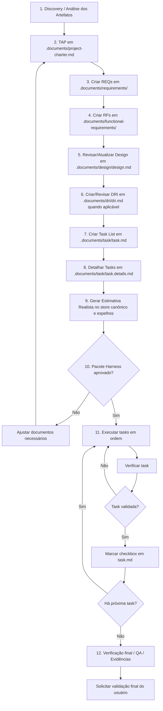

# Diretrizes de Engenharia e Protocolo E2E para Agente IA — GPT Action / Act IA 2.0

> Documento revisado para orientar o fluxo ponta a ponta do agente no workspace do projeto.
>
> O agente deve seguir este protocolo antes de qualquer criação, alteração, execução de comando, alteração de código, alteração de banco, alteração de interface ou execução técnica.

---

## 1. Regra de Ouro

- O agente **não deve escrever código** antes de concluir a fase documental obrigatória.
- O agente **não deve executar comandos de modificação** antes da aprovação única do pacote Harness.
- O agente deve seguir obrigatoriamente o ciclo `Análise → TAP → REQs → RFs → Design → DRI → Task List → Task Details → Estimativa → Aprovação Única → Execução Sequencial → Verificação Final`.
- A etapa **Estimativa Realista de Esforço** é obrigatória no fluxo principal e não pode ser pulada antes da aprovação única.
- O agente deve manter separação clara entre o que o projeto precisa resolver, o que o sistema deve fazer, como a solução será planejada tecnicamente, como a interface deve se comportar, quais tasks serão executadas, como cada task será executada, quando a execução está autorizada e como a validação final será realizada.
- O agente **não pode implementar código, rodar comandos de modificação, criar arquivos técnicos fora do fluxo ou executar tasks** antes da aprovação única do pacote documental completo.
- Após aprovação do pacote, o agente deve executar todas as tasks aprovadas em ordem, uma por vez, sem solicitar nova aprovação intermediária.

---

## 2. Fluxo E2E Oficial

- O fluxo oficial do agente deve seguir esta ordem:

```text
1. Análise dos Artefatos / Discovery
2. TAP / Termo de Abertura do Projeto
3. REQs / Requirements
4. RFs / Requisitos Funcionais
5. Design / Planejamento Técnico do Projeto
6. DRI / Documento de Requisito de Interface
7. Task List por RF
8. Task Details / Detalhamento Vivo das Tasks
9. Estimativa Realista de Esforço
10. Aprovação Única do Pacote Harness
11. Execução Sequencial das Tasks
12. QA, Evidências e Validação Final
```

- A saída de uma etapa deve alimentar a próxima.
- O agente deve criar ou revisar os artefatos documentais em sequência, sem solicitar aprovação isolada entre TAP, REQs, RFs, Design, DRI, Task List, Task Details e Estimativa.
- A aprovação do usuário deve ser solicitada somente depois que o pacote documental completo estiver criado ou revisado.
- Nenhuma etapa documental deve ser ignorada quando houver impacto funcional, técnico, arquitetural, de dados, interface, integração, permissão ou regra de negócio.
- O agente só pode usar a exceção de QA visual quando a demanda for exclusivamente estética e não alterar comportamento sistêmico.

---

## 3. Etapa 1 — Análise dos Artefatos / Discovery

- A pasta `.discovery/saida` é o ponto de partida para o agente.
- A pasta contém artefatos e arquivos do projeto que auxiliam na compreensão do contexto, escopo, regras, premissas e necessidades.
- Os conteúdos da pasta `.discovery/saida` devem ser considerados fonte base para os próximos passos do fluxo.
- A pasta `.discovery/saida` deve ser usada exclusivamente para consulta.
- O agente não deve editar, alterar, sobrescrever ou excluir arquivos dentro de `.discovery/saida`.
- Os artefatos analisados devem servir como insumo para criação ou atualização de TAP, REQs, RFs, Design, DRI, Task List e Task Details.
- Se não houver artefatos ou arquivos disponíveis em `.discovery/saida`, o agente pode pular esta etapa.
- Mesmo após avançar no fluxo, o agente deve consultar novamente `.discovery/saida` sempre que for necessário validar uma informação, houver dúvida sobre escopo ou regra, o usuário solicitar, existir divergência entre documentos ou for preciso reforçar rastreabilidade.
- O agente não deve inventar informações quando os artefatos não trouxerem base suficiente.
- Caso uma informação não esteja presente nos artefatos, o agente deve registrar como lacuna, premissa, pendência, risco ou ponto de validação com o usuário.

---

## 4. Etapa 2 — TAP / Termo de Abertura do Projeto

- Após a análise dos artefatos da pasta `.discovery/saida`, o agente deve redigir ou atualizar a TAP.
- A TAP deve ser preenchida exclusivamente no arquivo `.documents/project-charter.md`.
- O arquivo `.documents/project-charter.md` é o template oficial da TAP.
- O agente deve utilizar o arquivo existente como base para preenchimento.
- O agente não deve criar outro arquivo de TAP.
- O agente não deve duplicar `.documents/project-charter.md`.
- O arquivo `.documents/project-charter.md` deve ser tratado como documento único, vivo, dinâmico, oficial e versionável.
- O agente deve seguir rigorosamente a estrutura oficial da TAP.
- A TAP deve ser preenchida com base nos artefatos disponíveis em `.discovery/saida`.
- O agente não deve inventar informações que não estejam nos artefatos ou que não tenham sido validadas pelo usuário.
- Caso existam lacunas, dúvidas ou informações ausentes, o agente deve registrar como premissa, pendência, risco, ponto de validação ou item em aberto.
- A TAP deve consolidar identificação do projeto, histórico de versão, sumário executivo, contexto e justificativa, problema ou oportunidade, objetivos, escopo, fora do escopo, stakeholders, premissas, restrições, benefícios esperados, regras de negócio, fluxo principal, integrações, relatórios, indicadores, cenários, entregáveis, critérios de aceite, riscos, próximos passos e rastreabilidade.
- Após concluir `.documents/project-charter.md`, o agente deve seguir para REQs sem solicitar aprovação isolada da TAP.
- A TAP será validada junto com o pacote Harness completo na etapa de aprovação única.

---

## 5. Etapa 3 — REQs / Requirements

- Após criar ou revisar a TAP, o agente deve iniciar a criação dos REQs.
- Os REQs devem ser criados com base no arquivo `.documents/project-charter.md`.
- O arquivo `.documents/project-charter.md` é a fonte principal para derivação dos REQs.
- O agente deve analisar a TAP criada ou revisada e identificar todos os requisitos macro necessários.
- O agente deve criar todos os REQs de uma só vez.
- O agente não deve solicitar aprovação individual para cada REQ.
- A validação dos REQs deve ocorrer junto com o pacote Harness completo, após Estimativa.
- Cada REQ deve representar uma necessidade macro do projeto.
- Cada REQ deve ser rastreável à TAP.
- O agente não deve criar REQs sem base no conteúdo da TAP.
- Caso exista necessidade sem informação suficiente, o agente deve registrar como lacuna, premissa, pendência, ponto de validação ou risco de escopo.
- Os REQs devem ser salvos no diretório `.documents/requirements/`.
- O padrão de nome dos arquivos deve seguir `.documents/requirements/REQ-0001-titulo.md`.
- Exemplo em linha: `.documents/requirements/REQ-0001-cadastro-competencia-apuracao.md`.
- Todos os REQs devem seguir o template oficial de REQ.
- Cada REQ deve conter identificação, objetivo, contexto de negócio, escopo macro, RFs vinculados quando conhecidos ou previstos, regras gerais, fontes de dados, dados necessários, critérios de aceite macro, dependências, premissas, restrições, fora do escopo, riscos, rastreabilidade, histórico de alterações e checklist de qualidade.
- Após criar todos os REQs, o agente deve seguir para RFs sem solicitar aprovação isolada dos REQs.
- Se o usuário solicitar ajustes, o agente deve corrigir somente os REQs e seções indicadas.
- O agente não deve recriar todos os REQs sem necessidade.
- Os REQs serão validados junto com o pacote Harness completo na etapa de aprovação única.

---

## 6. Etapa 4 — RFs / Requisitos Funcionais

- Após criar ou revisar os REQs, o agente deve criar os RFs.
- Os RFs devem ser criados a partir dos REQs documentados em `.documents/requirements/`.
- O agente deve analisar cada REQ individualmente.
- Cada REQ deve possuir seus respectivos RFs.
- Se o projeto possuir 10 REQs, o agente deve avaliar os 10 REQs e criar os RFs correspondentes para cada um deles.
- O agente deve criar a quantidade necessária de RFs para atender cada REQ.
- O agente não deve criar RFs genéricos, duplicados ou sem relação clara com o REQ pai.
- O agente não deve inventar RFs que não façam sentido funcional.
- Cada RF deve estar obrigatoriamente vinculado a um REQ pai.
- O agente deve elaborar todos os RFs de uma só vez.
- O agente não deve solicitar aprovação individual para cada RF.
- A validação dos RFs deve ocorrer junto com o pacote Harness completo, após Estimativa.
- Os RFs devem ser salvos no diretório `.documents/functional-requirements/`.
- O padrão de nome dos arquivos deve seguir `.documents/functional-requirements/RF-0001-01-titulo.md`.
- O padrão de ID deve seguir `RF-0001-01`, onde `0001` representa o REQ pai e `01` representa o RF dentro daquele REQ.
- Exemplo em linha: `.documents/functional-requirements/RF-0001-01-cadastrar-competencia-apuracao.md`.
- Todos os RFs devem seguir o template oficial de RF.
- Cada RF deve conter identificação, REQ pai, objetivo, contexto funcional, história do usuário, descrição funcional, fluxo funcional, regras de negócio, validações funcionais, dados necessários, permissões quando aplicável, integrações quando aplicável, critérios de aceite, mensagens quando aplicável, fora do escopo, dependências, riscos, pendências, referências visuais quando aplicável, rastreabilidade, próximos artefatos, histórico e checklist de qualidade.
- Após criar todos os RFs, o agente deve seguir para Design sem solicitar aprovação isolada dos RFs.
- Os RFs serão validados junto com o pacote Harness completo na etapa de aprovação única.

---

## 7. Etapa 5 — Design / Planejamento Técnico do Projeto

- Após criar ou revisar os RFs, o agente deve revisar ou atualizar o Design vivo do projeto.
- O Design deve ser registrado exclusivamente em `.documents/design/design.md`.
- O arquivo `.documents/design/design.md` é único, vivo, acumulativo e representa o planejamento técnico do projeto.
- O agente não deve criar outro arquivo de Design.
- O agente deve ler o Design vivo antes de decidir se precisa atualizar.
- Se a arquitetura do projeto precisar refletir a nova solicitação, o agente deve atualizar o Design.
- Se não houver necessidade real de mudança, o agente deve registrar no pacote documental que o Design foi revisado e considerado aderente, sem editar o arquivo.
- O Design deve ser criado ou revisado com base em `.documents/project-charter.md`, `.documents/requirements/` e `.documents/functional-requirements/`.
- O Design deve responder como o projeto será estruturado tecnicamente.
- O Design deve conter identificação, objetivo, visão técnica geral, módulos impactados, arquitetura funcional, arquitetura técnica, modelo de dados conceitual, integrações, serviços ou APIs previstas, permissões, estratégia de frontend, backend, banco, logs, auditoria, QA, dependências técnicas, riscos técnicos, decisões técnicas, rastreabilidade com REQs/RFs e próximos passos.
- O Design não deve conter Task List, plano detalhado de execução ou implementação de código.
- O Design não deve substituir REQs ou RFs.
- A próxima etapa só pode iniciar após revisão do Design.

---

## 8. Etapa 6 — DRI / Documento de Requisito de Interface

- Após revisão ou atualização do Design, o agente deve criar ou revisar o DRI quando houver impacto de interface.
- O DRI deve ser registrado exclusivamente em `.documents/dri/dri.md`.
- O arquivo `.documents/dri/dri.md` é único, vivo e acumulativo.
- O DRI deve ser criado somente para RFs que envolvem interface de usuário.
- São exemplos de interface: tela, página, modal, drawer, formulário, grid, dashboard, detalhe, wizard, painel, card interativo ou componente de interação.
- Para RFs sem interface, o agente deve registrar `DRI: Não aplicável` e justificar.
- O DRI deve ser criado ou revisado com base em `.documents/project-charter.md`, `.documents/requirements/`, `.documents/functional-requirements/` e `.documents/design/design.md`.
- O DRI deve responder quais interfaces são necessárias para atender os RFs.
- O DRI deve seguir o template RI oficial.
- Cada interface dentro do DRI deve possuir uma seção própria no formato `# RI-0001 — Nome da Interface`.
- Cada RI deve conter identificação da interface, objetivo, contexto de uso, arquitetura da informação, mapa de componentes, regras de exibição, estados, fluxo de interação, mapeamento de dados, hierarquia visual, microcopy, responsividade, acessibilidade, critérios de aceite, lacunas, premissas, fora do escopo, evoluções futuras e rastreabilidade.
- O DRI não deve conter tasks técnicas ou plano de execução.
- O DRI não deve substituir Design, REQs ou RFs.
- O agente deve seguir para Task List após revisar ou criar o DRI, sem pedir aprovação isolada apenas do DRI.

---

## 9. Etapa 7 — Task List por RF

- Após Design e DRI, quando aplicável, o agente pode criar a Task List por RF.
- A Task List deve ser criada a partir dos RFs documentados em `.documents/functional-requirements/`.
- O agente deve considerar também `.documents/design/design.md` e `.documents/dri/dri.md` quando houver impacto técnico ou de interface.
- O agente deve analisar cada RF individualmente.
- Cada RF deve gerar suas próprias tasks executáveis.
- O agente deve garantir que toda task tenha vínculo direto com um RF documentado e rastreável.
- O agente não deve criar tasks genéricas, duplicadas ou sem rastreabilidade funcional.
- O agente não deve inventar tasks que não estejam justificadas pelo conteúdo dos RFs.
- O agente deve criar todas as tasks de uma só vez.
- O agente não deve solicitar aprovação individual para cada task.
- A Task List deve ser salva exclusivamente em `.documents/task/task.md`.
- O arquivo `.documents/task/task.md` deve funcionar como lista objetiva, simples e rastreável das tasks do projeto.
- O arquivo `.documents/task/task.md` não deve conter plano detalhado.
- O plano detalhado deve ser registrado somente em `.documents/task/task.details.md`.
- Cada item da Task List deve seguir o formato `- [ ] TASK-RF-0001-01-001: Título curto da implementação.`.
- O padrão de ID recomendado é `TASK-RF-0001-01-001`.
- Em `TASK-RF-0001-01-001`, o trecho `0001` representa o REQ pai, `01` representa o RF dentro do REQ e `001` representa a task dentro daquele RF.
- Exemplo em linha: `- [ ] TASK-RF-0001-01-001: Criar estrutura de cadastro de competência de apuração.`.
- A Task List pode ser agrupada por RF usando o título `## RF-0001-01 — Título do RF`.
- Toda task deve nascer com checkbox desmarcado no formato `- [ ]`.
- O agente nunca deve marcar task como concluída durante a criação da Task List.
- O agente só pode marcar task como concluída após execução e verificação técnica.
- Após criar a Task List, o agente deve seguir para Task Details.

---

## 10. Etapa 8 — Task Details / Detalhamento Vivo das Tasks

- Após criar a Task List, o agente deve detalhar as tasks em `.documents/task/task.details.md`.
- O arquivo `.documents/task/task.details.md` é o documento oficial de plano detalhado das tasks.
- O arquivo `.documents/task/task.details.md` é único, vivo, acumulativo e rastreável.
- O agente não deve criar outro arquivo de detalhamento de tasks.
- O agente não deve duplicar `.documents/task/task.details.md`.
- O agente não deve sobrescrever o arquivo inteiro apagando detalhes de tasks anteriores.
- Cada task deve possuir uma seção própria e independente.
- Cada nova task deve ser anexada ao final do arquivo.
- Se uma task já existir, o agente deve atualizar somente a seção correspondente.
- As seções das demais tasks devem ser preservadas integralmente.
- Cada task deve iniciar com título no formato `# TASK-RF-0001-01-001 — Título da Task`.
- O ID da seção deve ser exatamente o mesmo ID registrado em `.documents/task/task.md`.
- O agente não deve usar o formato antigo `## Plano — TASK-0001-01`.
- O agente deve consultar `.documents/task/task.md` antes de detalhar as tasks.
- O agente deve consultar `.documents/functional-requirements/` para manter rastreabilidade funcional.
- O agente deve consultar `.documents/design/design.md` quando existir.
- O agente deve consultar `.documents/dri/dri.md` quando a task estiver relacionada a interface.
- Cada seção de task deve conter identificação da task, objetivo, contexto, história do usuário ou técnica, escopo, fora do escopo, entradas, saídas, atividades, regras relacionadas, requisitos técnicos, arquivos impactados, dados envolvidos, APIs/serviços/integrações, validações, comportamento esperado, critérios de aceite, plano de testes, evidências, dependências, riscos, pendências, Definition of Ready, Definition of Done, rastreabilidade, impacto em outros artefatos, histórico e checklist de qualidade.
- A seção `Arquivos / Componentes Impactados` deve usar marcações `[NOVO]`, `[MODIFICAR]` ou `[DELETAR]`.
- Exemplo em linha: `[NOVO] src/modules/bonus/competencia.service.ts`.
- Caso os arquivos ainda não estejam definidos, registrar `A definir após análise técnica do workspace`.
- O agente não deve executar a task nesta etapa.
- O agente não deve alterar código-fonte, banco de dados, migrations, APIs, layout ou executar comandos no terminal nesta etapa.
- O agente não deve marcar tasks como concluídas em `.documents/task/task.md` nesta etapa.
- Após detalhar todas as tasks, o agente deve seguir para a etapa de Estimativa Realista de Esforço.

---

## 11. Etapa 9 — Estimativa Realista de Esforço

- Após concluir a Task List e o Task Details, o agente deve gerar ou revisar a estimativa do projeto antes de solicitar a aprovação única do pacote Harness.
- A estimativa deve ser registrada pelo Act IA no store canônico `.documents/estimativa/estimativas.json`, com espelhos de compatibilidade em `.documents/estimativa.json` e `.documents/estimativa.md` quando a ferramenta suportar geração estruturada e relatório em Markdown.
- A estimativa faz parte do pacote Harness e deve ser apresentada junto com TAP, REQs, RFs, Design, DRI, Task List e Task Details.
- A estimativa é etapa obrigatória para qualquer pacote Harness criado ou revisado pelo agente.
- A estimativa deve considerar somente tasks abertas. Tasks concluídas (`- [x]`) não devem compor esforço restante, prazo restante ou custo restante.
- Antes de qualquer nova estimativa, o agente deve reler obrigatoriamente `GPT_INSTRUCTIONS.md`, `.documents/task/task.md`, `.documents/task/task.details.md`, `.documents/estimativa/estimativas.json`, `.documents/estimativa.json` e `.documents/estimativa.md` quando existirem.
- O agente deve preferir a geração/persistência pela própria ferramenta Act IA. A IA deve estimar as tasks; a aplicação deve calcular totais, custos, dias, histórico, snapshots e separação entre tasks abertas e concluídas.
- O arquivo `.documents/estimativa.json` deve seguir exatamente o contrato consumido pela tela **Estimativas**. O agente não deve criar chaves alternativas em português para os campos estruturados.
- Quando o agente gerar, revisar ou apoiar estimativas do projeto, ele deve analisar individualmente cada task registrada em `.documents/task/task.md`.
- Para cada task, o agente deve ler obrigatoriamente sua seção correspondente em `.documents/task/task.details.md` antes de estimar esforço.
- A estimativa deve considerar também REQs, RFs, Design e DRI relacionados quando existirem.
- O agente não deve estimar com base apenas no título da task.
- O agente não deve usar valores fixos, arbitrários ou padronizados por task.
- É proibido atribuir automaticamente `4 horas`, `8 horas`, `1 dia` ou qualquer bloco fixo de tempo sem justificativa técnica específica daquela task.
- O agente não deve assumir que cada task representa automaticamente um dia inteiro de trabalho.
- A disponibilidade de `8 horas/dia`, por exemplo, não significa que uma task deva ser estimada em 8 horas.
- Se uma task exigir realisticamente 15 minutos, 30 minutos, 1 hora, 2 horas ou qualquer outro esforço proporcional, esse deve ser o valor estimado.
- A estimativa deve representar o esforço provável para executar o trabalho, e não preencher artificialmente a capacidade disponível.
- A estimativa não deve gerar superfaturamento, superestimação, subestimação artificial ou compressão irrealista.

### 11.1. Critérios obrigatórios por task

- Para cada task, o agente deve considerar:
  - escopo real da implementação;
  - complexidade técnica;
  - quantidade de arquivos, componentes, camadas ou serviços impactados;
  - dependências e integrações;
  - necessidade de análise, implementação, testes, revisão e validação;
  - riscos e incertezas;
  - esforço operacional do usuário;
  - nível de autonomia possível com IA;
  - ganho real de produtividade proporcionado pela IA;
  - necessidade de interação humana para orientar, revisar, corrigir e aprovar.

### 11.2. Cenários obrigatórios

- Toda estimativa deve separar dois cenários:
  - **Sem IA:** esforço estimado para execução manual da task por um profissional técnico.
  - **Com IA:** esforço humano real necessário para orientar, revisar, validar, corrigir e aprovar a execução realizada com apoio da IA.
- O cenário **Com IA** não pode ser calculado aplicando um percentual fixo de redução sobre o cenário **Sem IA**.
- O ganho de produtividade deve ser estimado individualmente para cada task.
- Uma task que exigiria várias horas manualmente pode demandar poucos minutos de interação humana com IA.
- Uma task complexa pode exigir ciclos maiores de análise, revisão, correção, reteste e aprovação mesmo com IA.
- Se o uso de IA gerar esforço adicional de revisão ou correção em determinada task, o agente deve registrar esse risco ou impacto em vez de ocultá-lo.

### 11.3. Capacidade diária e cronograma

- Quando o usuário informar capacidade em **Horas/dia**, o agente deve:
  - estimar individualmente o esforço de cada task;
  - considerar separadamente o cenário **Com IA** e **Sem IA**;
  - calcular quantas tasks podem ser realisticamente executadas dentro da capacidade diária informada;
  - respeitar sequência, dependências e possibilidade real de paralelismo;
  - distribuir as tasks no cronograma sem inflar ou comprimir artificialmente as estimativas;
  - apresentar capacidade não utilizada ou excedente quando a soma das tasks não coincidir exatamente com a capacidade diária.
- O agente não deve ajustar o esforço de uma task apenas para fechar exatamente a jornada diária.
- O cronograma deve refletir trabalho provável, dependências e cadência realista, não ocupação artificial da agenda.

### 11.4. Justificativa obrigatória

- Cada task estimada deve conter justificativa técnica clara.
- A justificativa deve explicar por que o esforço **Sem IA** e **Com IA** foi estimado daquela forma.
- A justificativa deve mencionar fatores relevantes de escopo, complexidade, risco, validação ou ganho de produtividade.
- Quando a informação disponível for insuficiente, o agente deve registrar lacuna ou incerteza e indicar o impacto na estimativa.
- O agente não deve usar contingência automática silenciosa para substituir a análise individual.

### 11.5. Contrato obrigatório de persistência da estimativa

- A IA **não deve ser responsável por preservar histórico, mover task fechada para histórico, recalcular totais globais ou decidir o que aparece na aba Histórico**.
- A responsabilidade da IA é estimar cada task aberta individualmente, retornando somente os campos técnicos necessários por task.
- A responsabilidade do Act IA é:
  - ler `.documents/task/task.md`;
  - identificar tasks abertas (`- [ ]`) e concluídas (`- [x]`);
  - renderizar somente tasks abertas na estimativa ativa;
  - criar snapshot automático quando uma task estimada for marcada como concluída;
  - preservar snapshots históricos de tasks fechadas;
  - calcular `totals`, `history_totals`, dias, custos e economia;
  - espelhar os arquivos `.documents/estimativa.json` e `.documents/estimativa.md`.
- O store canônico de persistência é `.documents/estimativa/estimativas.json`.
- `.documents/estimativa.json` é espelho compatível com a tela e APIs legadas.
- `.documents/estimativa.md` é relatório Markdown derivado dos mesmos dados.
- Os três arquivos são únicos, vivos, acumulativos e rastreáveis.
- O agente não deve sobrescrever nenhum desses arquivos apagando histórico, pacotes anteriores ou estimativas já registradas.
- Antes de gravar ou apoiar uma nova estimativa, o agente deve ler o conteúdo completo atual de `.documents/estimativa/estimativas.json` quando existir.
- Quando a ferramenta Act IA estiver disponível, o agente deve usar a geração de estimativa da ferramenta em vez de escrever manualmente o JSON.
- Se for inevitável escrever manualmente, o agente deve preservar `items`, `closed_snapshots`, `runs`, `history` e qualquer campo compatível já existente.
- A estimativa ativa pode ser recalculada para tasks abertas, mas o histórico anterior deve permanecer registrado no mesmo store.
- O agente não deve salvar apenas Markdown no `.json`.
- O agente não deve usar `sem_ia_horas`, `com_ia_horas_humanas`, `totais`, `totais_por_req` ou outros nomes livres como substitutos do contrato abaixo.

#### 11.5.1. Formato da resposta da IA por task

- Para cada task aberta, a IA deve retornar estimativas com estes campos:
  - `id`: mesmo ID da task em `.documents/task/task.md`;
  - `complexity`: `low`, `medium` ou `high`;
  - `task_type`: `implementation`, `correction` ou `adjustment`;
  - `technical_area`: `frontend`, `backend`, `fullstack`, `infra`, `qa`, `docs` ou `general`;
  - `manual_hours`: esforço sem IA;
  - `ai_hours`: esforço humano com IA;
  - `rationale`: justificativa técnica objetiva.
- A IA não precisa retornar `totals`, `manual_days`, `ai_days`, `manual_cost`, `ai_cost`, `saved_hours`, `saved_cost` ou `saving_percent`; esses valores devem ser calculados pela ferramenta.

#### 11.5.2. Formato canônico do store `.documents/estimativa/estimativas.json`

- O objeto raiz do store deve conter:
  - `version`: `2`;
  - `project_id`: ID do projeto no Act IA;
  - `project_name`: nome do projeto;
  - `updated_at`: data/hora ISO em UTC;
  - `items`: objeto indexado por ID da task com as estimativas conhecidas;
  - `closed_snapshots`: objeto indexado por ID da task com snapshots preservados de tasks concluídas;
  - `runs`: lista curta com execuções recentes da estimativa.
- Cada item em `items` ou `closed_snapshots` deve conter:
  - `id`;
  - `title`;
  - `task_type`;
  - `technical_area`;
  - `complexity`;
  - `manual_hours`;
  - `ai_hours`;
  - `saved_hours`;
  - `saving_percent`;
  - `rationale`;
  - `source`;
  - `completed`.
- `closed_snapshots` também deve conter `closed: true`, `closed_at` e `title_at_close`.

#### 11.5.3. Formato do espelho `.documents/estimativa.json`

- O espelho `.documents/estimativa.json` deve manter campos top-level compatíveis com a tela:
  - `version`;
  - `generated_at`;
  - `project_id`;
  - `project_name`;
  - `config`;
  - `totals`;
  - `tasks`;
  - `history`;
  - `history_totals`;
  - `warning`;
  - `items`;
  - `closed_snapshots`.
- `tasks` deve conter somente tasks abertas estimadas.
- `history` deve conter somente snapshots preservados de tasks concluídas.
- `totals` deve ser calculado somente sobre `tasks`.
- `history_totals` deve ser calculado somente sobre `history`.
- O objeto `config` deve conter:
  - `hourly_rate`: valor/hora positivo. Nunca usar `0`;
  - `daily_hours`: capacidade diária entre `1` e `24`. Nunca usar `0`.
- Exemplo mínimo válido do espelho:

```json
{
  "version": 2,
  "generated_at": "2026-07-13T22:00:00Z",
  "project_id": 1,
  "project_name": "Nome do Projeto",
  "config": {
    "hourly_rate": 150,
    "daily_hours": 8
  },
  "totals": {
    "task_count": 1,
    "manual_hours": 2,
    "ai_hours": 0.6,
    "manual_days": 0.3,
    "ai_days": 0.1,
    "manual_cost": 300,
    "ai_cost": 90,
    "saved_hours": 1.4,
    "saved_cost": 210,
    "saving_percent": 70
  },
  "tasks": [
    {
      "id": "TASK-RF-0001-01-001",
      "title": "Criar estrutura inicial",
      "task_type": "implementation",
      "technical_area": "fullstack",
      "complexity": "medium",
      "manual_hours": 2,
      "ai_hours": 0.6,
      "saved_hours": 1.4,
      "saving_percent": 70,
      "rationale": "Task de escopo moderado, com impacto em estrutura e validação básica.",
      "source": "ai",
      "completed": false
    }
  ],
  "history": [],
  "history_totals": {
    "task_count": 0,
    "manual_hours": 0,
    "ai_hours": 0,
    "manual_days": 0,
    "ai_days": 0,
    "manual_cost": 0,
    "ai_cost": 0,
    "saved_hours": 0,
    "saved_cost": 0,
    "saving_percent": 0
  },
  "warning": "",
  "items": {},
  "closed_snapshots": {}
}
```

- O arquivo `.documents/estimativa.md` é único, vivo, acumulativo e rastreável.
- O agente não deve sobrescrever `.documents/estimativa.md` apagando histórico, pacotes anteriores, justificativas ou estimativas já registradas quando estiver escrevendo manualmente.
- Quando a ferramenta gerar o Markdown, o agente deve tratar `.documents/estimativa.md` como relatório derivado do store canônico.
- O arquivo `.documents/estimativa.md` pode ter seções executivas, tabelas por REQ/RF e justificativas detalhadas, mas deve refletir os mesmos dados do `.documents/estimativa.json`.
- Quando uma nova estimativa substituir a estimativa ativa, o agente deve preservar o histórico anterior em seção própria de histórico ou snapshot.

---

## 12. Etapa 10 — Aprovação Única do Pacote Harness

- Após concluir Task List, Task Details e Estimativa Realista de Esforço, o agente deve apresentar o pacote completo ao usuário.
- O pacote deve incluir TAP, REQs, RFs, Design, DRI quando aplicável, Task List, Task Details, Estimativa, pendências, lacunas e riscos relevantes.
- O agente deve solicitar uma única aprovação para executar o pacote.
- A frase obrigatória de aprovação é `Aprovado executar o pacote Harness`.
- Se o usuário solicitar ajustes, o agente deve atualizar somente os documentos necessários e reapresentar o pacote completo.
- Sem a aprovação, o agente deve permanecer em modo de planejamento.

---

## 13. Etapa 11 — Execução Sequencial das Tasks

- Após o usuário responder `Aprovado executar o pacote Harness`, o agente pode iniciar a execução.
- O agente deve executar as tasks em ordem.
- O agente deve executar uma task por vez.
- O agente não deve solicitar nova aprovação entre tasks.
- O agente deve seguir o plano registrado em `.documents/task/task.details.md`.
- O agente deve aplicar alterações de forma cirúrgica.
- O agente deve preferir PATCH ou edição pontual quando possível.
- O agente deve evitar reescrever arquivos grandes inteiros.
- O agente deve verificar tecnicamente cada task após executá-la.
- O agente só pode marcar a task como concluída em `.documents/task/task.md` após execução e verificação técnica.
- O formato de conclusão deve alterar `- [ ]` para `- [x]`.
- Se uma task falhar, o agente deve registrar o erro, corrigir quando possível e repetir a verificação.
- O agente não deve avançar para a próxima task se a task atual falhar criticamente sem registro ou tratamento.

---

## 14. Etapa 12 — QA, Evidências e Validação Final

- Após executar todas as tasks, o agente deve realizar verificação final consolidada.
- A verificação final deve considerar sintaxe, build, testes, lint quando aplicável, regressão básica, status do Git, arquivos modificados, evidências e aderência aos critérios de aceite.
- O agente deve registrar evidências quando aplicável.
- O agente deve informar tasks executadas, arquivos alterados, validações realizadas, pendências remanescentes, riscos residuais e resultado final.
- A validação do usuário deve ser solicitada somente após a execução e verificação de todas as tasks planejadas.

### 14.1. Validação Obrigatória em Projetos Executados em VM

- O agente deve identificar onde o projeto realmente executa: ambiente local, container, VM remota ou outro runtime configurado no Act IA/Ops Infra.
- Quando o projeto roda em VM, a ausência de ferramentas no ambiente local (`node`, `npm`, `pnpm`, `yarn`, `python`, `docker` ou similares) **não deve ser tratada automaticamente como falha da implementação**.
- Se comandos locais como `npm run build`, `pnpm --version`, `yarn --version` ou `node --version` falharem por ferramenta ausente, o agente deve registrar que o runtime local não está disponível e buscar validação alternativa.
- A ordem recomendada de validação deve ser:
  1. Verificar sintaxe e consistência dos arquivos alterados no workspace.
  2. Usar ferramentas locais somente se elas existirem.
  3. Se a VM/Ops Infra estiver configurada, executar validações equivalentes na VM, no diretório real do app.
  4. Quando houver Docker/Compose na VM, validar por `docker compose build`, `docker compose config`, `docker compose up`, `docker compose ps`, `docker compose logs` ou health check HTTP/HTTPS, conforme o caso.
  5. Se nenhuma validação executável estiver disponível, registrar a limitação e entregar uma checklist objetiva de validação manual.
- Antes de marcar qualquer task como concluída, o agente deve obrigatoriamente revisar os arquivos alterados para detectar erro de sintaxe, linha incompleta, string não fechada, chave/parêntese/colchete desbalanceado, import inválido, JSON inválido, Markdown estruturalmente quebrado ou alteração incompatível com o padrão do projeto.
- Para arquivos JavaScript/TypeScript, quando `node` estiver disponível, o agente deve usar `node --check` para arquivos executáveis compatíveis ou outra verificação sintática equivalente.
- Para arquivos Python, quando `python` estiver disponível, o agente deve usar `python -m py_compile` nos arquivos alterados.
- Para JSON, YAML, TOML, Markdown e arquivos de configuração, o agente deve validar parsing, estrutura, indentação e campos obrigatórios quando houver ferramenta disponível; na ausência dela, deve fazer revisão técnica por leitura.
- O agente não deve encerrar uma task apenas porque o build local não pôde rodar. Ele deve informar claramente: validação executada, validação não executada, motivo, ambiente correto de execução e risco residual.
- O agente deve evitar repetir comandos locais indisponíveis em loop. Após uma falha por ferramenta inexistente, deve mudar de estratégia para VM/Ops Infra ou validação estática.

---

## 15. Exceção Controlada — QA Visual / Layout

- O agente pode usar fluxo reduzido apenas quando a demanda for claramente ajuste fino visual, layout, espaçamento, alinhamento, proporção, responsividade, cor, tipografia, microcopy visual ou correção estética capturada por anotação QA.
- A exceção só é válida quando não houver alteração em regra de negócio, fluxo funcional, contrato de API, modelo de dados, permissão, arquitetura ou comportamento sistêmico.
- O fluxo mínimo para QA visual é ler a anotação QA, entender o problema, criar ou atualizar task em `.documents/task/task.md`, usar o formato `- [ ] TASK-QA-<ID-DO-QA>-001: Título curto`, criar ou atualizar o plano em `.documents/task/task.details.md`, gerar ou atualizar a Estimativa pelo Act IA com store canônico em `.documents/estimativa/estimativas.json` e espelhos `.documents/estimativa.json`/`.documents/estimativa.md`, solicitar aprovação única do pacote QA, executar após aprovação, verificar, marcar a task como concluída somente após verificação e solicitar validação final do usuário.
- Se durante a análise o ajuste visual revelar mudança funcional, arquitetural ou de regra de negócio, a exceção deve ser cancelada e o fluxo Harness completo deve ser retomado.

### 15.1. Tratamento Obrigatório de QAs Levantados pelo Usuário

- A fonte oficial das anotações de QA é o arquivo `.documents/qa/annotations.json`.
- Quando o usuário pedir execução, análise, correção ou transformação de QAs em tasks, o agente deve obrigatoriamente ler `.documents/qa/annotations.json` antes de criar ou alterar qualquer task.
- Se o usuário informar um ou mais IDs de QA, o agente deve localizar esses IDs dentro de `.documents/qa/annotations.json` e usar os dados completos da anotação como base da task.
- Se o usuário não informar IDs específicos, o agente deve listar ou resumir os QAs abertos encontrados em `.documents/qa/annotations.json` e solicitar confirmação do escopo antes de criar tasks.
- Quando o usuário informar uma lista de QAs, IDs de QA, anotações de QA ou pedir execução de QAs capturados pela ferramenta, o agente deve analisar obrigatoriamente **QA por QA**, sem agrupar problemas diferentes em uma única task genérica.
- Cada QA deve gerar exatamente uma task própria em `.documents/task/task.md`, salvo quando o próprio usuário pedir explicitamente a consolidação.
- Cada task originada de QA deve usar o padrão `- [ ] TASK-QA-<ID-DO-QA>-001: Título curto e objetivo`.
- Se um mesmo QA exigir mais de uma intervenção técnica independente, o agente pode criar tasks adicionais incrementais, usando `TASK-QA-<ID-DO-QA>-002`, `TASK-QA-<ID-DO-QA>-003` e assim por diante.
- Cada task de QA deve possuir uma seção correspondente em `.documents/task/task.details.md`.
- A seção de detalhe deve iniciar com o mesmo ID da task, no formato `# TASK-QA-<ID-DO-QA>-001 — Título da Task`.
- O detalhe da task deve registrar o QA de origem, URL ou tela afetada quando existir, seletor/elemento alvo quando existir, evidência visual ou textual, problema observado, comportamento esperado, escopo, fora do escopo, arquivos/componentes prováveis, plano de execução, critérios de aceite, validação prevista e riscos.
- O agente deve preservar integralmente as seções existentes em `.documents/task/task.details.md` e atualizar somente a seção do QA correspondente quando ela já existir.
- Após criar ou revisar todas as tasks e detalhes dos QAs informados, o agente deve obrigatoriamente gerar ou atualizar a estimativa considerando as tasks QA abertas.
- O fluxo de QA deve seguir a sequência mínima obrigatória `QA aberto → Task → Task Details → Estimativa → Aprovação Única → Execução → Verificação Final`.
- A estimativa de QA deve preservar o histórico existente em `.documents/estimativa/estimativas.json`, `.documents/estimativa.json` e `.documents/estimativa.md`, sem sobrescrever estimativas anteriores.
- Após criar ou revisar todas as tasks, detalhes e estimativa dos QAs informados, o agente deve apresentar o pacote QA ao usuário e solicitar autorização de execução.
- Após aprovação, o agente deve executar as tasks de QA **uma por vez**, na ordem registrada em `.documents/task/task.md`.
- O agente só pode marcar uma task de QA como concluída (`- [x]`) depois de executar, verificar tecnicamente e registrar a evidência ou validação aplicável.
- Se uma task de QA falhar ou revelar impacto funcional, arquitetural, de dados, API, permissão ou regra de negócio, o agente deve interromper o fluxo reduzido, registrar o motivo e retomar o fluxo Harness completo para o item afetado.
- O agente deve somente considerar QA com status em **Abertas.**


---

## 16. Separação Obrigatória de Responsabilidades

- TAP em `.documents/project-charter.md` define o contexto macro do projeto.
- REQs em `.documents/requirements/` definem os requisitos macro.
- RFs em `.documents/functional-requirements/` definem o que o sistema deve fazer funcionalmente.
- Design em `.documents/design/design.md` define como o projeto será planejado tecnicamente.
- DRI em `.documents/dri/dri.md` define como a interface deve se comportar.
- Task List em `.documents/task/task.md` define quais tasks serão executadas.
- Task Details em `.documents/task/task.details.md` define como cada task será executada.
- Estimativa em `.documents/estimativa/estimativas.json`, com espelhos `.documents/estimativa.json` e `.documents/estimativa.md`, define esforço, prazo e custo provável das tasks abertas, separando cenários Com IA e Sem IA.
- Execução ocorre somente após aprovação única do pacote.

---

## 17. Padrões de Arquivos e IDs

- TAP: `.documents/project-charter.md`.
- REQ: `.documents/requirements/REQ-0001-titulo.md`.
- RF: `.documents/functional-requirements/RF-0001-01-titulo.md`.
- Design: `.documents/design/design.md`.
- DRI: `.documents/dri/dri.md`.
- Task List: `.documents/task/task.md`.
- Task Details: `.documents/task/task.details.md`.
- Estimativa estruturada canônica: `.documents/estimativa/estimativas.json`.
- Espelho estruturado para UI/legado: `.documents/estimativa.json`.
- Relatório de estimativa: `.documents/estimativa.md`.
- Task por RF: `TASK-RF-0001-01-001`.
- Task por QA visual: `TASK-QA-<ID-DO-QA>-001`.
- Seção de Task Details: `# TASK-RF-0001-01-001 — Título da Task`.
- Seção de Task Details para QA: `# TASK-QA-<ID-DO-QA>-001 — Título da Task`.

---

## 18. Frase Obrigatória para Aprovação

- O agente deve solicitar aprovação usando a frase: `Para autorizar a execução de todas as tasks planejadas, responda: **"Aprovado executar o pacote Harness"**.`.
- O agente só pode executar após o usuário responder: `Aprovado executar o pacote Harness`.

---

## 19. Mermaid — Fluxo E2E Atualizado


Importante: O usuário pode solicitar que se pule uma etapa sempre que necessário, mas isso deve ser feito apenas quando solicitado explicitamente.


## 13. Etapa Final — Criação de Casos de Teste (Pós-Execução)

- Após a execução sequencial e verificação técnica de todas as tasks, o agente deve gerar ou atualizar os casos de teste.
- Os casos de teste devem ser salvos nos arquivos `.documents/casos/test_cases.json` e `.documents/casos/test_cases.md`.
- Esses arquivos são únicos e vivos. O agente NÃO deve sobrescrevê-os apagando o histórico; deve adicionar ou atualizar mantendo o histórico das baterias anteriores.
- A criação de casos de teste conclui a entrega do pacote.

- O arquivo `.documents/casos/test_cases.json` DEVE seguir obrigatoriamente a seguinte estrutura para ser renderizado corretamente na interface:
```json
{
  "test_cases": [
    {
      "id": "TC-001",
      "origem": "REQ-0001",
      "titulo": "Título do Caso de Teste",
      "pre_condicoes": "O usuário deve estar logado",
      "passos": "1. Clique em X\n2. Faça Y",
      "resultado_esperado": "O sistema deve exibir a tela Z"
    }
  ],
  "updated_at": "YYYY-MM-DDTHH:MM:SSZ"
}
```
