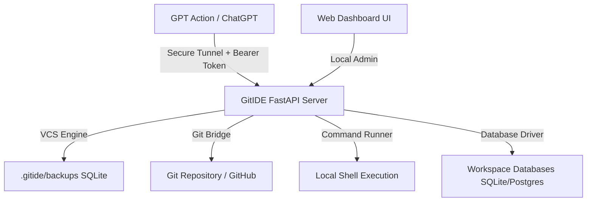

# GitIDE: LLM-Permissive Workspace & Git Bridge

GitIDE is a lightweight local server designed to act as a workspace manager and simple version control system (VCS) optimized for LLMs (like custom GPT Actions). It gives AI agents the freedom to edit, delete, query databases, and execute commands, while acting as a bridge to standard Git repositories for deployment.

---

## User Review Required

> [!IMPORTANT]
> **Exposing the Local Server to the GPT Action:**
> Since custom GPT Actions run in the cloud, they must be able to send HTTP requests to your local computer. We will use a secure tunnel (like Ngrok or Cloudflare Tunnel) combined with a **mandatory API Key (Bearer Token)** authentication system to ensure only your authorized GPT Action can read, edit, or execute commands on your computer.

---

## Proposed Changes

We will build the GitIDE workspace manager in the workspace directory. It will contain a FastAPI backend and a beautiful, high-fidelity CSS/JS dashboard interface.

### Component Breakdown

#### [NEW] [requirements.txt](file:///c:/Users/augus/.workspace/gitide/requirements.txt)
Python dependencies required for GitIDE:
- `fastapi` & `uvicorn` (server engine)
- `gitpython` (interacting with Git repositories)
- `sqlalchemy` (orm for local SQLite database tracking backups and configuration)
- `pydantic` (data validation)
- `jinja2` (serving the frontend HTML dashboard)

#### [NEW] [gitide_server/database.py](file:///c:/Users/augus/.workspace/gitide/gitide_server/database.py)
A local SQLite database setup to track:
- **Projects**: name, path, Git remote URL, active configuration.
- **Activity Logs**: timestamps, what file was modified, what tool was run, command executions.
- **File Snapshots/Backups**: version history of file contents, allowing instantaneous "undo/rollback" for any file modification.

#### [NEW] [gitide_server/vcs.py](file:///c:/Users/augus/.workspace/gitide/gitide_server/vcs.py)
VCS Engine to manage file reads, edits, deletes, and backups:
- Before any file write/delete, a snapshot of the current file is saved in SQLite or a backup folder.
- Keeps files clean and simple for the GPT, avoiding merge conflicts.

#### [NEW] [gitide_server/git_bridge.py](file:///c:/Users/augus/.workspace/gitide/gitide_server/git_bridge.py)
Interfaces with Git for deployments:
- Clones remote repositories.
- Performs staging, commits, and pushes to GitHub/GitLab.
- Handles authentication credentials safely.

#### [NEW] [gitide_server/main.py](file:///c:/Users/augus/.workspace/gitide/gitide_server/main.py)
Main FastAPI application defining the REST API for the GPT Action and dashboard:
- `GET /openapi.json` (auto-generated schema for the GPT Action config).
- **Authentication**: Custom Bearer Token security dependency.
- **Files API**: List, read, write, edit, delete.
- **Shell API**: Execute terminal commands in project workspaces.
- **Database API**: Run SQLite database queries inside project environments.
- **Git API**: Clone, pull, status, commit, deploy.
- **Logs & Rollback API**: View action history and restore file snapshots.

#### [NEW] [gitide_server/static/](file:///c:/Users/augus/.workspace/gitide/gitide_server/static/)
Dashboard frontend:
- **index.html**: Glassmorphic, modern responsive UI.
- **app.js**: Visualizes workspace directories, shell outputs, database contents, Git deployment progress, and rollback logs.
- **style.css**: Dark-themed developer interface with glowing neon-indigo accents, CSS variables, transitions, and sleek typography (Inter font).

#### [NEW] [run.bat](file:///c:/Users/augus/.workspace/gitide/run.bat)
Windows startup script to automatically configure virtual environment, install requirements, and start the FastAPI server on `http://127.0.0.1:8000`.

---

## Verification Plan

### Automated Tests
- Script to run basic API tests (`test_api.py`) verifying file creation, editing, snapshot recovery, and database query endpoints.

### Manual Verification
1. Start the server locally using `run.bat`.
2. Open the dashboard at `http://127.0.0.1:8000` to verify the dashboard loads and visualizes local projects.
3. Test files API using Curl or Swagger interface (`http://127.0.0.1:8000/docs`).
4. Generate a test GPT Action OpenAPI schema and check that it describes all operations properly.
