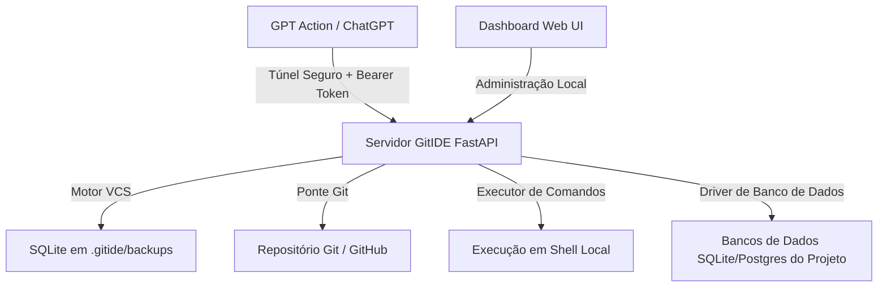

# GitIDE: Workspace Permissivo para LLMs e Ponte Git

O GitIDE é um servidor local leve projetado para atuar como gerenciador de workspace e sistema de controle de versão (VCS) simplificado otimizado para LLMs (como GPT Actions customizadas). Ele dá aos agentes de IA total liberdade para editar, excluir, consultar bancos de dados e executar comandos no terminal, servindo ao mesmo tempo como uma ponte para repositórios Git padrão para a realização de deploys.

---

## Revisão do Usuário Necessária

> [!IMPORTANT]
> **Exposição do Servidor Local para a GPT Action:**
> Como as GPT Actions rodam na nuvem (servidores da OpenAI), elas precisam enviar requisições HTTP para o seu computador local. Nós usaremos um túnel seguro (como Ngrok ou Cloudflare Tunnel) combinado com um sistema de autenticação **obrigatório por API Key (Bearer Token)** para garantir que apenas a sua GPT Action autorizada possa ler, editar ou executar comandos no seu computador.

---

## Mudanças Propostas

Construiremos o gerenciador de workspace GitIDE no diretório de workspace. Ele conterá um backend em FastAPI (Python) e um painel visual moderno em HTML/CSS/JS para o dashboard.

### Estrutura de Componentes

#### [NOVO] [requirements.txt](file:///c:/Users/augus/.workspace/gitide/requirements.txt)
Dependências Python necessárias para o GitIDE:
- `fastapi` e `uvicorn` (servidor web e rotas)
- `gitpython` (integração com repositórios Git)
- `sqlalchemy` (persistência no banco SQLite local para logs e snapshots de arquivos)
- `pydantic` (validação de dados das APIs)
- `jinja2` (renderização do painel HTML administrativo)

#### [NOVO] [gitide_server/database.py](file:///c:/Users/augus/.workspace/gitide/gitide_server/database.py)
Configuração do banco de dados SQLite interno do GitIDE para rastrear:
- **Projetos**: nome, caminho absoluto no computador, URL remota do Git, status.
- **Histórico de Atividades**: data/hora, arquivo alterado, ferramenta usada, comandos executados.
- **Snapshots/Backups de Arquivos**: versões anteriores de arquivos modificados para permitir o recurso de "Desfazer/Rollback" instantâneo de qualquer edição feita pelo GPT.

#### [NOVO] [gitide_server/vcs.py](file:///c:/Users/augus/.workspace/gitide/gitide_server/vcs.py)
Motor VCS simplificado para gerenciar leituras, escritas, exclusões e backups de arquivos:
- Antes de qualquer escrita ou remoção, salva uma cópia de segurança do arquivo atual no SQLite/diretório de backup.
- Mantém o workspace limpo para o GPT, evitando problemas complexos de conflitos de merge do Git tradicional durante a codificação ativa.

#### [NOVO] [gitide_server/git_bridge.py](file:///c:/Users/augus/.workspace/gitide/gitide_server/git_bridge.py)
Interface com o Git para deploy:
- Inicializa repositórios Git locais.
- Faz o staging (add), commit com mensagens personalizadas e push para o GitHub/GitLab.
- Lida de forma segura com credenciais de acesso do Git.

#### [NOVO] [gitide_server/main.py](file:///c:/Users/augus/.workspace/gitide/gitide_server/main.py)
Aplicação principal FastAPI que expõe a API REST para a GPT Action e para o Dashboard:
- `GET /openapi.json` (esquema OpenAPI gerado automaticamente para colar na configuração da sua GPT Action).
- **Autenticação**: Dependência de segurança para validar o Bearer Token.
- **API de Arquivos**: Listar arquivos recursivamente, ler, escrever, editar e excluir.
- **API de Execução**: Rodar comandos shell/terminal de forma assíncrona.
- **API de Banco de Dados**: Executar queries SQL em bancos do projeto (ex: SQLite) para o GPT depurar e criar tabelas.
- **API de Git**: Status, pull, commit e push (deploy).
- **API de Backups e Histórico**: Ver modificações recentes e restaurar versões antigas.

#### [NOVO] [gitide_server/static/](file:///c:/Users/augus/.workspace/gitide/gitide_server/static/)
Interface visual do dashboard administrativo:
- **index.html**: Interface moderna com estilo de vidro (glassmorphism) e design escuro (dark mode).
- **app.js**: Lógica do painel para explorar a árvore de arquivos, visualizar logs em tempo real, executar comandos pelo terminal web, gerenciar conexões do banco de dados e acionar rollbacks de segurança.
- **style.css**: Estilização premium baseada em Tailwind ou variáveis CSS customizadas, com tipografia moderna (fonte Inter), sombras neon-indigo e transições suaves.

#### [NOVO] [run.bat](file:///c:/Users/augus/.workspace/gitide/run.bat)
Script em lote (.bat) para Windows que criará o ambiente virtual Python, instalará as dependências do `requirements.txt` e iniciará o servidor FastAPI rodando localmente em `http://127.0.0.1:8000`.

---

## Plano de Verificação

### Testes Automatizados
- Executar um script básico de teste de API (`test_api.py`) para validar os endpoints de gravação de arquivos, rollback automático e execução de comandos.

### Verificação Manual
1. Iniciar o servidor com o `run.bat`.
2. Acessar o dashboard em `http://127.0.0.1:8000` e verificar se a interface de controle carrega.
3. Testar chamadas locais de criação de arquivos através da documentação interativa Swagger (`http://127.0.0.1:8000/docs`).
4. Gerar o arquivo JSON de configuração da OpenAPI e conferir se ele define corretamente todos os endpoints para a GPT Action.
