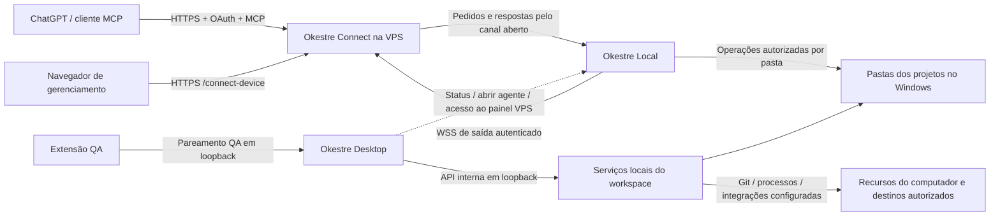

# Plano de arquitetura e organização E2E — Okestre Local

Data: 2026-10-21. Estado: proposta para revisão; nenhuma implementação autorizada por este documento.
Repositório analisado: `C:\Users\augus\.workspace\okestre`.
Branch observada: `codex/local-agent-bridge`; HEAD: `6693812`.

## 1. Objetivo e limites

Organizar o produto e o código por responsabilidade, preservando os quatro componentes que já existem:

1. **Okestre Connect** — nome proposto para o serviço de conexão na VPS.
2. **Okestre Local** — agente Windows que compartilha pastas e executa operações autorizadas.
3. **Okestre Desktop** — interface completa de gestão e trabalho local.
4. **Extensão QA** — captura e envio de anotações; permanece no produto.

A VPS deve apresentar somente a interface de conexão/gerenciamento de dispositivos. Isso não significa manter somente uma rota HTTP: autenticação, OAuth, MCP e WebSocket continuam necessários por trás dessa interface.

A pasta `.documents/` já existe e continua sendo o local de todas as documentações do projeto. Preservar integralmente suas subpastas, arquivos, nomes e caminhos atuais. Não transferir esse conteúdo para `docs/`, não recriar a estrutura e não substituir as documentações existentes. A mudança é apenas acrescentar a subpasta `agentsflow/` para receber o contrato indicado.

Única movimentação de contrato prevista:

```text
GPT_INSTRUCTIONS.md
  → .documents/agentsflow/agentflow.md
```

Preservar o conteúdo atual em formato `agentflow TB`, inclusive regras, nós, textos e referência ao template ER. Não converter o documento, reescrever suas regras, alterar aprovação ou reconstruí-lo a partir de versões antigas do Git. Os demais contratos permanecem onde estão; eventuais referências ao nome antigo serão atualizadas pontualmente na futura implementação.

Nesta etapa: somente este plano. Não mover código, contratos ou dados; não atualizar executáveis, dependências, VM, banco, configuração ou projetos cadastrados. Não encerrar aplicativos.

## 2. Método e alcance da análise

Análise estática dos pontos de entrada, dependências, rotas, persistência, empacotamento, documentação e testes existentes. Não foram executados deploy, login no GPT, operações remotas, comandos Git em projetos privados nem a bateria de testes. A matriz de testes abaixo é proposta de validação futura, não resultado já obtido.

Foram examinados: `gitide_server/main.py`, `local_bridge.py`, `mcp_server.py`, `mcp_oauth.py`, `agent.py`, `okestre_local/protocol.py`, `paths.py`, `okestre_desktop/runtime.py`, `api.py`, `qa_bridge.py`, manifesto da extensão, Dockerfile, scripts de build, requisitos e documentação dos componentes.

O estado publicado na VPS não foi inspecionado. A presença de testes e descrições de validações anteriores não comprova funcionamento do ambiente público atual.

## 3. Diagnóstico da arquitetura atual

| Área | Evidência no código | Consequência |
|---|---|---|
| Servidor central | `gitide_server/main.py` tem 7.885 linhas e reúne UI, APIs de projetos, autenticação, integrações, MCP e ponte | Alterar o servidor afeta vários produtos; ocultar menus não isola a VPS |
| Desktop | `okestre_desktop/runtime.py` importa `gitide_server.main` e reutiliza `existing.app` | O Desktop carrega também rotas e dependências que pertencem ao servidor remoto |
| Ponte | `local_bridge.py` mantém canais e pedidos em memória, usando SQLite para dispositivos | Serviço atual exige um processo e uma réplica; não planejar escala horizontal sem nova arquitetura |
| Protocolo | VPS importa contratos de `okestre_local.protocol` | Dependência de servidor em pacote do agente; contrato de transporte merece pacote próprio |
| MCP | `mcp_server.py` importa VCS, Git, modelos de banco e terminal do servidor | Exige extração de adaptadores para que a VPS não ofereça execução local acidental |
| Local vs. remoto | Projetos `device` são encaminhados à ponte; APIs antigas `/api/projects/{id}/...` respondem 409 para eles | Há dois caminhos de execução e diferentes identidades de projeto |
| Agente Local | Cliente, executor, política de caminhos, terminal e GUI já estão separados | Preservar protocolo, pareamento, permissões e perfil; reorganização não exige reescrever o agente |
| Extensão QA | Ponte local em `okestre_desktop/qa_bridge.py`, token de sessão e escopo QA | Canal independente da conexão GPT/VPS; deve continuar funcionando sem a VPS |
| Frontend | UI geral em `gitide_server/static`, UI Desktop adicional e React Flow em `frontend/flowcharts` | Código-fonte, artefatos compilados e pontos de entrada precisam de convenção clara |
| Documentação | `LOCAL_AGENT.md` e `DESKTOP.md` incluem descrições anteriores de recursos já evoluídos | Revalidar documentação contra código; não tratá-la como contrato atual isoladamente |
| Contrato | Sincronização de `GPT_INSTRUCTIONS.md` com overwrite; leitura do agente depende do nome na raiz | Risco de sobrescrever personalizações e recriar o arquivo antigo após uma migração apenas manual |
| Conteúdo do contrato | Agente nativo limita leitura a 1.600 caracteres em Ollama ou 12.000 em outros provedores | Mudar caminho não garante leitura integral; definir comportamento explícito para truncamento, sem reescrever o conteúdo |
| Empacotamento | Build Desktop coleta arquivos `*.md` da raiz | Mover o contrato para `.documents` sem alterar o build o retiraria do pacote |
| Docker | `COPY . .`; não foi encontrado `.dockerignore` na raiz | Imagem deve passar a usar entradas explícitas e exclusões; não concluir vazamento real sem inspecionar imagens publicadas |
| Raiz do repositório | Diversos `fix_*`, `update_*`, `patch_*`, arquivos temporários e ZIPs históricos | Mistura entre produto, manutenção pontual e distribuição; classificar antes de mover ou remover |

## 4. Arquitetura-alvo



Esse desenho representa canais reais, não uma cadeia obrigatória Connect → Local → Desktop → extensão. O GPT acessa os arquivos pela ponte/agente; o Desktop opera localmente; a extensão QA conecta ao Desktop. Fechar o Desktop não deve desligar o agente Local. Não transformar o Desktop em requisito para o GPT alcançar uma pasta já compartilhada.

### 4.1 Okestre Connect — VPS

Responsabilidades:

- Login, sessão, conta e autorização.
- Parear, listar, revogar e mostrar status de dispositivos.
- Vincular projetos a identificadores opacos de pastas autorizadas.
- Expor OAuth/MCP e encaminhar operações para o agente correspondente.
- Persistir somente metadados necessários, credenciais protegidas/concessões e auditoria sem conteúdo de arquivos.
- Mostrar conexão do GPT, escopos, dispositivo offline e falhas de comunicação de forma compreensível.

Não deve hospedar editor de código, terminal da VPS para projetos locais, editor ER, fluxogramas, Harness, execução de IA do workspace ou arquivos dos projetos. Recursos de banco/integrações hoje presentes precisam ser classificados antes de retirar rotas; clientes dependentes devem ser identificados, nunca desativados silenciosamente.

O conteúdo solicitado pelo GPT ainda transita na memória da VPS e pelo provedor de IA. “Arquivos locais” significa ausência de cópia persistente do projeto na VPS, não ausência de trânsito de dados.

### 4.2 Nome e rotas

Proposta de nome: **Okestre Connect**. Texto da tela: **Conectar dispositivos**. Rota canônica proposta: `/connect-device`.

- Manter `/local-devices` como alias/redirecionamento compatível durante a transição.
- Não renomear junto os endpoints `/api/local/*`, o WebSocket `/api/local/connect` ou `/mcp` e `/mcp/`.
- Atualizar links do Desktop e da GUI do agente apenas em releases próprios; clientes antigos continuam funcionais pelo alias.
- `/` pode redirecionar para o painel de dispositivos após autenticação.
- Preservar domínio público, issuer OAuth, endpoints de descoberta e callbacks já usados. Mudança visual não justifica novo pareamento.

Superfícies que precisam continuar na VPS: `/login`, `/api/auth/login`, sessão/logout correspondentes, `/connect-device`, alias `/local-devices`, arquivos estáticos do painel, `/api/local/status`, `/api/local/devices`, `/api/local/claim`, ações de gerenciamento `/api/local/{action}`, WSS `/api/local/connect`, MCP `/mcp[/]`, descoberta `.well-known`, registro/autorização/token OAuth e consentimento, além das APIs de concessões/revogação/auditoria que o painel utilizar. Inventariar as rotas geradas pela biblioteca OAuth antes de fechar a allowlist; não inferir que todos os caminhos estejam escritos literalmente em `main.py`.

### 4.3 Okestre Local

Manter GUI/bandeja, configuração DPAPI, raízes autorizadas, política de caminhos, snapshots, deduplicação, terminal, reconexão e protocolo v1. Não adicionar interface de gestão de projeto nem chave de IA ao agente.

A extração do protocolo compartilhado será uma alteração de organização/importação, com camada temporária de reexportação para compatibilidade. Nenhuma mudança de mensagens ou de permissões deve ser embutida nessa movimentação.

### 4.4 Okestre Desktop

Manter toda a interface atual: arquivos, documentos, diagramas ER, fluxogramas, fluxo do projeto, UI, terminal, Git, Ops Infra, banco, tokens, QA, testes E2E, métricas, estimativas, histórico, agente, Harness e Discovery.

Criar inicialização própria para o servidor embutido em loopback, sem importar a aplicação completa da VPS. Autenticação de lançamento, verificação Host/Origin, sessão local e ponte QA permanecem explícitas. O Desktop usa serviços de workspace locais; não deve encaminhar operações comuns à VPS quando pode realizá-las localmente.

### 4.5 Extensão QA

Preservar extensão, permissões necessárias à captura, configuração local, seleção explícita de projeto e modo remoto existente enquanto houver consumidores. O token QA não recebe acesso de terminal/Git/arquivos genéricos.

Manter ausência de expiração por tempo solicitada pelo usuário: código de uso único; conexão encerrada por revogação ou encerramento do Desktop. Preservar a identidade da extensão e testar o impacto de mudar o diretório de uma instalação descompactada antes de reorganizar sua pasta.

## 5. Hierarquia semântica proposta para o repositório

Estrutura final sugerida, a ser atingida por etapas, não por movimentação em massa:

```text
okestre/
├── apps/
│   ├── connect/                     # aplicação publicada na VPS
│   │   ├── src/okestre_connect/
│   │   │   ├── app.py               # composição exclusiva da VPS
│   │   │   ├── auth/                # sessão, OAuth, consentimento
│   │   │   ├── devices/             # pareamento, revogação, status
│   │   │   ├── relay/               # WebSocket, canais, pedidos
│   │   │   ├── mcp/                 # transporte e adaptador remoto
│   │   │   └── persistence/         # dispositivos, grants, metadados
│   │   └── web/                    # somente painel Connect
│   ├── local-agent/
│   │   └── src/okestre_local/       # preservar nome do pacote público
│   ├── desktop/
│   │   ├── src/okestre_desktop/     # janela, runtime, ações nativas, QA
│   │   └── web/                    # conexão local e integração da janela
│   └── qa-extension/               # manifesto, worker, conteúdo, painel
├── packages/
│   ├── protocol/src/okestre_protocol/ # mensagens v1 e erros compartilhados
│   ├── workspace/src/okestre_workspace/
│   │   ├── projects/               # cadastro local e resolução de raízes
│   │   ├── files/                  # leitura, escrita, conflito e histórico
│   │   ├── git/                    # operações Git locais
│   │   ├── terminal/               # execução e ciclo de processos
│   │   ├── documents/              # bootstrap e migração de documentos
│   │   ├── harness/                # requisitos, tasks, testes
│   │   ├── diagrams/               # ER, fluxogramas e fluxo do projeto
│   │   ├── qa/                     # anotações, evidências e exportações
│   │   ├── ops/                    # infraestrutura e permissões
│   │   ├── integrations/           # provedores, banco e credenciais locais
│   │   └── agents/                 # contexto e ferramentas da IA nativa
│   └── workspace-ui/               # fontes da interface completa local
│       ├── shell/                  # menu, projeto ativo, tema
│       ├── features/               # uma pasta por módulo funcional
│       └── shared/                 # componentes e recursos realmente comuns
├── resources/templates/            # modelos oficiais, ER, task, test etc.
├── .documents/                     # pasta EXISTENTE; manter toda a documentação
│   ├── ...                         # todas as subpastas e arquivos atuais, intactos
│   └── agentsflow/                 # acrescentar sem reorganizar o restante
│       └── agentflow.md             # somente GPT_INSTRUCTIONS.md movido e renomeado
├── outputs/                        # artefatos de distribuição, nunca fontes
├── OPS_INFRA_OPERATOR.md           # permanece na raiz nesta etapa
├── PROD_READINESS_VALIDATOR.md     # permanece na raiz nesta etapa
└── SECURITY_RULES.md               # permanece na raiz nesta etapa
```

A árvore acima é resumida: `...` representa toda a estrutura atual de `.documents`, sem exclusões ou movimentações. Não será criada uma pasta `docs/` para substituir esse acervo. O diretório `packages/workspace/.../documents/` representa código de serviço, não o armazenamento das documentações dos projetos.

Por decisão do usuário, não haverá pastas centrais `plan/`, `tests/`, `scripts/` ou `deploy/` na arquitetura-alvo. Dentre essas pastas auxiliares propostas, apenas `outputs/` permanece. Não criar também a hierarquia de subpastas unit/integration/contract/e2e/packaging ou build/migration/maintenance apresentada anteriormente.

- Planos e decisões ficam em `.documents/`, respeitando sua organização existente.
- Testes automatizados necessários ficam junto ao componente que validam, sem uma árvore central de testes.
- Comandos de build e rotinas de migração/manutenção necessários ficam no componente responsável, sem uma árvore central de scripts.
- Dockerfile e configuração de publicação do Connect ficam diretamente em `apps/connect/`, sem `deploy/connect/`.
- As referências a `tests/...` e `scripts/...` neste diagnóstico identificam arquivos atuais, não pastas obrigatórias na arquitetura-alvo.
- Essa decisão não autoriza apagar testes, scripts ou documentos existentes. Sua realocação será mapeada na implementação futura, preservando funcionalidades e validações.
- Este plano permanece no caminho em que foi criado nesta etapa; sua futura organização em `.documents/` será feita junto à reorganização autorizada, sem movimentação agora.

Outros contratos e documentos de política também permanecem na localização atual. `resources/templates` não terá segunda cópia editável de `agentflow.md`: o build deve copiar a fonte canônica explicitamente. Evitar duplicação entre contrato do repositório e contrato distribuído.

Antes de introduzir o layout `src`, definir instalação dos pacotes, entrypoints, imports e build reproduzível. Não trocar simplesmente os diretórios e esperar que os atuais imports continuem funcionando. A estrutura não exige reescrever toda a UI em React; preservar HTML/JS existentes e organizar gradualmente. O React Flow é um módulo, não uma migração obrigatória da interface inteira.

## 6. Regras de dependência

- `okestre_protocol` não depende de UI, banco, aplicações, provedores IA ou executor.
- Connect depende do protocolo e de seus adaptadores remotos; não depende do runtime Desktop, da GUI Local ou dos serviços de execução do workspace.
- Local depende de protocolo, segurança de caminhos e execução local. Não importa aplicação Connect/Desktop.
- Desktop compõe serviços de workspace e UI, sem importar o app Connect.
- Serviços do workspace não importam janela pywebview nem variáveis globais de `main.py`.
- Frontends chamam APIs documentadas; não acessam diretamente bancos ou cofre de credenciais.
- Evitar um novo pacote `common` que volte a concentrar toda a aplicação. Compartilhar somente contratos e serviços com responsabilidade verificável.
- Compartilhar código de terminal pode ser adequado; compartilhar o processo ou o ciclo de vida entre Local e Desktop não é obrigatório e mudaria o comportamento atual.

## 7. Dados e identidades: preservar antes de reorganizar

| Dado | Local atual / destino preservado | Regra |
|---|---|---|
| Pastas de projetos | Caminhos escolhidos pelo usuário | Não mover nem copiar para VPS |
| Perfil Desktop | `%LOCALAPPDATA%\OkestreDesktop` | Preservar banco, registros e perfil WebView |
| Dados do servidor local | `%LOCALAPPDATA%\OkestreDesktop\server` | Separar módulos de código sem mudar o diretório de dados |
| Acessos Git/infra | Cofre/configuração existentes do perfil | Não expor segredos; conservar a chave de descriptografia |
| Perfil Local | `%LOCALAPPDATA%\OkestreLocal` | Preservar DPAPI, raízes, token e histórico |
| Metadados Connect | Volume atual configurado por `GITIDE_DATA_DIR` / `~/.gitide` | Preservar identidades, sessões, grants, dispositivos e chaves |
| Arquivos de QA | `.documents/qa/annotations.json` | Continuam no projeto local |
| Documentações existentes | `.documents/` e todas as subpastas atuais | Preservar integralmente; não mover para `docs/` nem reorganizar |
| Contrato principal | `.documents/agentsflow/agentflow.md` | Migrar conteúdo existente, não aplicar template por cima |
| Executável Desktop | `outputs/okestre-desktop/OkestreDesktop/OkestreDesktop.exe` | Manter pasta oficial; sem criar versões paralelas |
| Executável Local | `outputs/okestre-local/OkestreLocal/OkestreLocal.exe` | Preservar distribuição e perfil atuais |

Documentar o mapeamento entre ID do projeto Desktop, ID do projeto na VPS, `device_id` e `root_id`. Não presumir que IDs numéricos coincidam. A VPS deve manter identificadores opacos, não caminhos absolutos do Windows. Uma pasta cadastrada no Desktop não passa automaticamente a ser compartilhada; preservar o consentimento do agente.

Antes de reduzir a VPS, inventariar projetos `storage_kind=server`. Se houver projetos reais nessa modalidade, planejar sua migração separadamente ou preservar o serviço antigo durante a transição. Não apagá-los nem convertê-los para `device` sem uma pasta local correspondente.

## 8. Migração específica do contrato

### 8.1 Caminho e conteúdo

Destino exato: `.documents/agentsflow/agentflow.md` (manter a grafia **agentsflow** solicitada).

Conteúdo atual observado: começa com `agentflow TB` e inclui `flow protocolo_engenharia["GPT_INSTRUCTIONS"]`. A troca de nome do arquivo não autoriza renomear esse nó, alterar a DSL ou modificar as regras. Preservar bytes; a extensão `.md` não implica conversão para Markdown convencional ou Mermaid `flowchart`.

SHA-256 observado do contrato nesta análise:
`b050439a5dbb601847dbd6f4c15809329520c04da305dfb65a720a9019647762`.
Esse hash é evidência de baseline desta análise, não uma versão universal obrigatória para todos os projetos. Cada projeto pode ter conteúdo personalizado.

### 8.2 Fluxo de migração por projeto — futuro, com dry-run

1. Inventariar origem e destino, hashes, permissões e status Git, sem reescrever nada.
2. Origem existe e destino não: copiar bytes para arquivo temporário no destino, validar hash, publicar atomicamente; só então retirar a origem após consumidores atualizados.
3. Ambos existem e são iguais: manter destino como canônico; retirar o legado apenas na etapa de limpeza compatível.
4. Ambos existem e diferem: marcar conflito; não escolher Git HEAD, template global, arquivo mais recente ou cópia empacotada automaticamente. Preservar ambos até decisão sobre aquele projeto.
5. Só destino existe: manter; migração idempotente.
6. Nenhum existe: criar a partir da referência empacotada somente no bootstrap de projeto novo; em projeto existente registrar a ausência antes de tratar como novo.
7. Registrar resultado por projeto, hash de origem/destino, backup e eventual conflito. Backup fora dos arquivos ativos do projeto; não criar dois contratos concorrentes.
8. Nunca migrar remotamente via shell genérico sem necessidade. Preferir rotina local do Desktop para as pastas acessíveis. Projetos somente compartilhados pelo agente exigem mecanismo explícito, com permissões e criação segura de diretórios; não supor que a API atual suporte rename/delete.

Durante uma release de transição, o leitor pode consultar o caminho antigo apenas se o novo estiver ausente. Não haverá escrita dupla. No estado final, retirar fallback e arquivo antigo após inventário sem consumidores legados. Projetos não acessíveis/offline ficam pendentes, não são declarados migrados.

### 8.3 Pontos do código que precisam mudar

| Ponto observado | Ajuste planejado |
|---|---|
| `main.py:sync_project_system_files` | Criar diretório de destino; sem overwrite automático do contrato existente; impedir recriação na raiz |
| `main.py` leitura de arquivos especiais | Resolver o novo caminho; leitura não deve sobrescrever o documento do usuário |
| `main.py` parâmetros do sistema | Registro explícito que mapeia o contrato para caminho canônico; validar allowlist/confinamento de caminho, inclusive subdiretórios |
| `main.py` orientação para mensagens Git | Atualizar somente referência nominal |
| `agent.py` prompt e `_safe_read_instruction` | Ler novo caminho e identificar corretamente contrato ausente; revisar corte silencioso de conteúdo |
| `static/index.html`, `settings-tabs.js` | Atualizar textos/prompt padrão; conferir também configurações já persistidas, sem substituir prompts personalizados |
| Outros contratos na raiz | Trocar referências ao caminho antigo, sem mover ou reescrever suas regras |
| `scripts/build-desktop.ps1` | Incluir explicitamente `.documents/agentsflow/agentflow.md`; glob de Markdown na raiz não basta |
| Docker/recursos de referência | Incluir somente recursos necessários ao componente; o Connect não distribui contratos para projetos reais |
| `update_gpt.py`, `patch_sync.py`, `temp_settings.html` | Classificar scripts antigos e impedir que voltem a gerar nome/caminho legado |
| Documentação e testes | Corrigir exemplos e contratos de leitura; incluir migração, conflitos e integridade |

Evitar substituição textual cega do termo `GPT_INSTRUCTIONS` dentro do próprio contrato. Referências históricas em backups/logs não são consumidores ativos e não precisam ser reescritas.

### 8.4 Responsável pela distribuição

O bootstrap/migrador de documentos deve pertencer ao workspace local, executado pelo Desktop, não ao painel Connect. Leitura ou listagem de projetos não deve sobrescrever contratos personalizados. Definir um registro central de recursos de referência e destinos; contrato principal é preservado após criação, templates de sintaxe têm política própria. Isso evita o problema já observado de versões empacotadas substituírem o documento do projeto.

## 9. Plano de execução por fases

| Fase | Entrega | Dependências | Critério de conclusão |
|---|---|---|---|
| 0. Baseline | Inventário de imports, rotas, dados, consumidores, builds e comportamentos atuais | Aprovação do escopo de implementação | Mapa de dependências e checklist de rollback; nenhum dado movido |
| 1. Contrato | Migrador com dry-run, leitores atualizados, build e registro de recursos | Fase 0 | Conteúdo preservado por hash, conflito tratado, novos projetos usam caminho novo |
| 2. Composição | Factories/entrypoints distintos para Connect e workspace Desktop | Fase 0; coordenar com 1 | Desktop não importa app remoto; Connect não monta módulos de trabalho local |
| 3. Protocolo | Extração de schemas v1 e adaptadores MCP remoto/local | Fase 2 | Compatibilidade com agente e plugin atuais; sem mudança de permissão/mensagem |
| 4. Connect | Painel único, alias de rota, OAuth/MCP/WS e imagem mínima | Fases 2 e 3 | Interface web reduzida; APIs necessárias presentes; módulos excluídos realmente indisponíveis |
| 5. Organização física | Mover módulos por domínio conforme árvore proposta, corrigir imports/entrypoints | Limites de 2/3 validados | Builds reproduzíveis, sem import circular ou novos acoplamentos |
| 6. UI e extensão | Organizar fontes/artefatos e testes; manter recursos/identidade | Fase 5 | Desktop completo e extensão QA operando, inclusive sem VPS |
| 7. Homologação E2E | Matriz abaixo em perfis isolados e VPS de homologação | Fases anteriores | Evidências por cenário, nenhuma perda de dados ou quebra de grants |
| 8. Distribuição | Atualização controlada, migração real e retirada de aliases internos temporários | Homologação e autorização operacional | Mesmas pastas/perfis, inventário reconciliado, rollback disponível |

Cada fase deve ter diff pequeno e revisável, commit próprio e verificação correspondente. Não combinar mudança de permissões, reformulação da UI e movimentação física de todo o código no mesmo lote. Adiar limpezas sem vínculo funcional até a compatibilidade estar provada.

## 10. Matriz de validação E2E proposta

| Cenário | Evidência de aceite |
|---|---|
| Connect novo | Login → pareamento → registro de pastas → projeto → consentimento OAuth → descoberta de ferramentas MCP |
| Cliente existente | Agente antigo conecta ao novo Connect; tokens, device/root IDs e grants preservados; alias `/local-devices` funciona |
| Leitura GPT | GPT/cliente MCP autorizado lê arquivo da pasta correta via WSS; VPS não cria cópia persistente |
| Escrita GPT | Hash correto grava; hash antigo recusa; snapshot local e replay impedem duplicação |
| Isolamento | Conta/projeto/pasta sem autorização não acessa dados; revogação interrompe acesso |
| Reconexão | Pausa, suspensão, queda da rede e restart VPS retornam estado claro; nenhuma mutação ambígua repetida automaticamente |
| Terminal | Operação longa acompanha command_id; stop encerra; scopes continuam exigidos; não introduzir prazo novo de execução |
| Desktop independente | Arquivos, Git, terminal, documentos e diagramas funcionam com Connect indisponível |
| Ciclos de vida | Fechar Desktop encerra seus processos e QA, mas mantém Local e conexão GPT independentes |
| QA | Parear extensão, selecionar projeto, capturar e persistir anotação; token QA não acessa outras APIs |
| Migração contrato | Origem/destino iguais em bytes; casos só origem, só destino, ambos iguais/diferentes, ausentes, offline e readonly |
| Reentrada | Reiniciar/listar/ler projetos não recria GPT_INSTRUCTIONS.md nem sobrescreve agentflow.md |
| IA nativa e GPT | Ambos resolvem caminho novo; contrato personalizado respeitado; ausência/truncamento declarados |
| Pacote Desktop | Executável isolado encontra contrato empacotado e cria projeto novo; não depende da árvore de desenvolvimento |
| Imagem Connect | Rotas de edição/terminal/IA local não montadas; imagem sem projetos, cofres, .venv, caches e outputs |
| Regressão UI | Todos os módulos Desktop existentes preservados; nomes e navegação consistentes |
| Rollback | Reverter release preserva perfis, dados, contrato e pareamentos, sem restaurar versão global por cima da personalização |

Reaproveitar testes atuais como base: `test_local_agent.py`, `test_local_bridge.py`, `test_local_main.py`, `test_local_devices_browser.py`, `test_mcp_server.py`, `test_mcp_oauth.py`, `test_desktop.py`, `test_desktop_qa_bridge.py`, testes de diagramas, Harness e E2E. A organização futura de testes não deve ser confundida com já ter executado a validação.

## 11. Empacotamento, implantação e rollback

- Separar dependências por artefato. Connect não precisa de pywebview/Tk ou ferramentas de conversão/IA local; Local mantém dependências leves; Desktop inclui workspace e UI.
- Criar manifesto explícito de recursos e arquivos de entrada do build. Incluir dependências compiladas locais, licenças e template do contrato; não copiar toda a árvore indiscriminadamente.
- Manter os caminhos oficiais dos executáveis/ZIPs. Não criar `okestre-desktop-v2` ou equivalente para uso normal.
- Gerar pacote verificável antes de pedir fechamento ao usuário. A aplicação em uso não será encerrada sem autorização.
- Preservar volume e segredos do Connect. Fazer backup consistente dos bancos antes de migrações, sem imprimi-los em logs.
- Até existir coordenação distribuída, manter um worker/uma réplica; documentar isso no deploy do Easypanel.
- Rollback de código não deve sobrescrever documentos. Manter release de transição capaz de ler caminho novo/legado; se for preciso reverter migração, usar backup específico por projeto e comparar hashes antes.
- Não retirar rotas ou dados `server` da VPS sem inventário dos consumidores. Nenhuma exclusão de workspace remoto está autorizada por este plano.

## 12. Decisões propostas para revisão

1. Nome de produto na VPS: **Okestre Connect**; página `/connect-device` e alias `/local-devices`.
2. Preservar nomes **Okestre Local** e **Okestre Desktop** e manter a extensão QA.
3. Separar app Connect de app workspace, antes de reorganizar fisicamente os diretórios.
4. Preservar toda a pasta `.documents/` existente. Migrar somente `GPT_INSTRUCTIONS.md` para `.documents/agentsflow/agentflow.md`, mantendo conteúdo exato por projeto.
5. Encerrar overwrite automático do contrato existente; migração explícita e inicialização somente quando apropriado.
6. Manter profiles, pastas de projetos, identidade do agente e diretórios oficiais de distribuição.
7. Não tratar migração de pastas como autorização para mudar semântica de segurança, aprovação, scopes ou funcionalidades.

## 13. Pendências para a futura implementação

- Inventário real da VPS: release, rotas consumidas, projetos server/device, volume e proxy.
- Validar quais integrações MCP além de arquivos/terminal ainda são usadas por clientes.
- Identificar prompts personalizados persistidos com referências legadas; produzir proposta de alteração, não substituir silenciosamente.
- Determinar mecanismo de criação/migração de documentos para projetos acessíveis só via agente, sem estender permissões inadvertidamente.
- Conferir identidade da extensão descompactada antes de alterar sua localização.
- Definir estratégia de leitura integral do agentflow dentro dos limites de contexto da IA; renomear arquivo não resolve truncamento.

## 14. Diretriz visual aprovada: estrutura visual e CSS do OpenHands

Reaproveitar exclusivamente a camada de apresentação do projeto localizado em `C:\Users\augus\.workspace\OpenHands-main\OpenHands-main` como referência e fonte de componentes visuais para o Okestre. O objetivo aprovado é usar a estrutura visual (carcaça) e o estilo do OpenHands, com a identidade Okestre. Não se trata de incorporar integralmente o frontend funcional do OpenHands.

### Escopo do reaproveitamento

- Layout das telas, cabeçalho, navegação, menus, painéis laterais e organização visual do workspace.
- CSS, temas, cores, tipografia, espaçamentos, bordas e estados visuais dos controles.
- Componentes de apresentação necessários para reproduzir esse padrão. Como parte da estrutura está em React, o reaproveitamento pode incluir a marcação e os componentes visuais, além do CSS, desacoplados das integrações do OpenHands.
- Aplicação consistente desse padrão às telas existentes do Okestre, incluindo arquivos, editor, terminal, Git, documentos, tarefas, testes E2E, QA, diagramas, fluxos e Ops Infra.

### Limites preservados

- Manter as funcionalidades, regras de negócio, dados e comportamentos do Okestre; adaptar sua apresentação ao novo padrão visual.
- Manter backend, APIs, execução de comandos, agente local, comunicação com a VM, pareamento e extensão QA do Okestre.
- Não incorporar o motor de agentes, SDK de execução, serviços, autenticação, contratos de API, telemetria ou integrações do OpenHands como consequência do reaproveitamento visual.
- Conectar os componentes visuais aos serviços existentes do Okestre. Não migrar automaticamente o estado funcional ou o armazenamento do OpenHands.
- Preservar os avisos de licença e autoria aplicáveis ao código reaproveitado. O repositório local inspecionado inclui licença MIT.

### Aplicação no plano

Na fase 6 (UI e extensão), mapear os componentes visuais reutilizáveis, separar suas dependências de apresentação das chamadas específicas do OpenHands e adaptar as telas do Okestre em lotes revisáveis. A aceitação exige consistência visual, navegação e acessibilidade, além da regressão dos comportamentos existentes. A referência visual não autoriza substituir o backend, alterar permissões ou remover módulos.

Esta diretriz registra uma decisão de planejamento. Nenhuma alteração de interface ou executável é realizada nesta etapa, e o `GPT_INSTRUCTIONS.md` permanece fora do escopo desta atualização documental.

## 15. Entrega desta análise

Somente este documento foi criado. Não houve reorganização, movimentação do contrato, mudança do GPT_INSTRUCTIONS.md, atualização de executáveis, alteração de banco, deploy ou execução de testes. A implementação depende de uma solicitação posterior explícita do usuário.
